<!--
  GENERATED FILE - DO NOT EDIT.
  Generated from SYSMODViews.sysml and SYSMOD.sysml by scripts/generate_views_doc.py.
  Edit the library and rerun the script instead.
-->

# SYSMOD Views

> This document is generated from the SYSMODViews library (v5.1.7). It is read-only; changes are made in [SYSMODViews.sysml](SYSMODViews.sysml) and the document is regenerated with `python scripts/generate_views_doc.py`.

The SYSMOD views follow ISO/IEC/IEEE 42010: stakeholders derived from the ISO/IEC/IEEE 15288 life cycle processes have concerns, viewpoints frame these concerns, and views conform to the viewpoints. The SYSMOD process steps refine the ISO/IEC/IEEE 15288 processes and produce the project elements that the views of a SYSMOD project expose, e.g., in the Delivery Drone example.

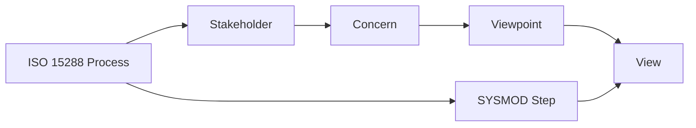

**Views, dependencies, and paths.** The views do not depend on each other; the content they show does. Every view is a projection of the one SYSMOD Project model, and the model elements it exposes build on other model elements, e.g., the stakeholder needs on the problem statement and the stakeholders. SYSMOD therefore separates the framework from the method: the framework (this document) defines what the views show and for whom, the SYSMOD process (`Project::defaultProcess`) defines a path through the steps that create the content. The process is a default, not a mandatory sequence: all steps after `SetupProject` are optional, e.g., the brownfield system in a greenfield project, the steps can be revisited in iterations, and the whole process is applied again to the `subProjects` on the next level of the system hierarchy. Chapter [6. View Dependencies](#6-view-dependencies) shows which views build on which other views, derived from the library.

## Contents

1. [ISO 15288 Processes](#1-iso-15288-processes)
2. [Stakeholders](#2-stakeholders)
3. [Concerns](#3-concerns)
4. [Viewpoints](#4-viewpoints)
5. [Views](#5-views)
6. [View Dependencies](#6-view-dependencies)

## 1. ISO 15288 Processes

The life cycle processes of ISO/IEC/IEEE 15288 as defined in the package `SYSMOD::ISO15288Processes`, the stakeholders responsible for them, and the SYSMOD process steps that refine them.

### Agreement Processes

| Process | Stakeholders | SYSMOD steps | Description |
|---|---|---|---|
| <a id="process-acquisition"></a>**Acquisition** | [Acquirer](#stakeholder-acquirer) | — | The Acquisition process obtains a product or service in accordance with the acquirer's requirements. |
| <a id="process-supply"></a>**Supply** | [Supplier](#stakeholder-supplier) | — | The Supply process provides an acquirer with a product or service that meets agreed requirements. |

### Organizational Project-Enabling Processes

| Process | Stakeholders | SYSMOD steps | Description |
|---|---|---|---|
| <a id="process-lifecyclemodelmanagement"></a>**Life Cycle Model Management** | — | — | The Life Cycle Model Management process defines, maintains, and assures availability of policies, life cycle processes, life cycle models, and procedures for use by the organization. |
| <a id="process-infrastructuremanagement"></a>**Infrastructure Management** | — | — | The Infrastructure Management process provides the infrastructure and services to projects to support organization and project objectives throughout the life cycle. |
| <a id="process-portfoliomanagement"></a>**Portfolio Management** | [PortfolioManager](#stakeholder-portfoliomanager) | — | The Portfolio Management process initiates and sustains necessary, sufficient, and suitable projects in order to meet the strategic objectives of the organization. |
| <a id="process-humanresourcemanagement"></a>**Human Resource Management** | — | — | The Human Resource Management process provides the organization with necessary human resources and maintains their competencies consistent with business needs. |
| <a id="process-qualitymanagement"></a>**Quality Management** | [QualityManager](#stakeholder-qualitymanager) | — | The Quality Management process assures that products, services, and implementations of the life cycle processes meet the organization's quality objectives and achieve customer satisfaction. |
| <a id="process-knowledgemanagement"></a>**Knowledge Management** | — | — | The Knowledge Management process creates the capability and assets that enable the organization to exploit opportunities to re-apply existing knowledge. |

### Technical Management Processes

| Process | Stakeholders | SYSMOD steps | Description |
|---|---|---|---|
| <a id="process-projectplanning"></a>**Project Planning** | [ProjectManager](#stakeholder-projectmanager) | `SetupProject` | The Project Planning process produces and coordinates effective and workable plans. |
| <a id="process-projectassessmentandcontrol"></a>**Project Assessment and Control** | [ProjectManager](#stakeholder-projectmanager) | — | The Project Assessment and Control process assesses if the plans are aligned and feasible, determines the status of the project, technical, and process performance, and directs execution to help ensure that the performance is according to plans and schedules, within projected budgets, and satisfies technical objectives. |
| <a id="process-decisionmanagement"></a>**Decision Management** | — | — | The Decision Management process provides a structured, analytical framework for objectively identifying, characterizing, and evaluating a set of alternatives for a decision at any point in the life cycle and selecting the most beneficial course of action. |
| <a id="process-riskmanagement"></a>**Risk Management** | [RiskManager](#stakeholder-riskmanager) | — | The Risk Management process continually identifies, analyzes, treats, and monitors risks. |
| <a id="process-configurationmanagement"></a>**Configuration Management** | [ConfigurationManager](#stakeholder-configurationmanager) | — | The Configuration Management process manages and controls system elements and configurations over the life cycle. |
| <a id="process-informationmanagement"></a>**Information Management** | — | — | The Information Management process generates, obtains, confirms, transforms, retains, retrieves, disseminates, and disposes of information to designated stakeholders. |
| <a id="process-measurement"></a>**Measurement** | — | — | The Measurement process collects, analyzes, and reports objective data and information to support effective management and demonstrate the quality of the products, services, and processes. |
| <a id="process-qualityassurance"></a>**Quality Assurance** | — | — | The Quality Assurance process helps ensure the effective application of the organization's Quality Management process to the project. |

### Technical Processes

| Process | Stakeholders | SYSMOD steps | Description |
|---|---|---|---|
| <a id="process-businessormissionanalysis"></a>**Business or Mission Analysis** | [ProductManager](#stakeholder-productmanager) | `SpecifyBrownfieldSystem`, `SpecifyProblemStatement`, `IdentifyStakeholders`, `PitchSystemIdea` | The Business or Mission Analysis process defines the business or mission problem or opportunity, characterizes the solution space, and determines potential solution class(es) that can address a problem or take advantage of an opportunity. |
| <a id="process-stakeholderneedsandrequirementsdefinition"></a>**Stakeholder Needs and Requirements Definition** | [RequirementsEngineer](#stakeholder-requirementsengineer) | `IdentifyStakeholders`, `ElaborateStakeholderNeeds` | The Stakeholder Needs and Requirements Definition process defines the stakeholder requirements for a system that can provide the capabilities needed by users and other stakeholders in a defined environment. |
| <a id="process-systemrequirementsdefinition"></a>**System Requirements Definition** | [RequirementsEngineer](#stakeholder-requirementsengineer) | `DefineSystemSpecification` | The System Requirements Definition process transforms the stakeholder, user-oriented view of desired capabilities into a technical view of a solution that meets the operational needs of the user. |
| <a id="process-systemarchitecturedefinition"></a>**System Architecture Definition** | [SystemArchitect](#stakeholder-systemarchitect) | `CreateFunctionalArchitecture`, `CreateLogicalArchitecture`, `CreateProductArchitecture` | The System Architecture Definition process generates system architecture alternatives, selects one or more alternatives that address stakeholder concerns and system requirements, and expresses this in consistent views and models. |
| <a id="process-designdefinition"></a>**Design Definition** | [DesignEngineer](#stakeholder-designengineer) | — | The Design Definition process provides sufficient detailed data and information about the system and its elements to enable the implementation consistent with the architectural entities as defined in the models and views of the system architecture. |
| <a id="process-systemanalysis"></a>**System Analysis** | [SystemAnalyst](#stakeholder-systemanalyst) | — | The System Analysis process provides a rigorous basis of data and information for technical understanding to aid decision-making across the life cycle. |
| <a id="process-implementation"></a>**Implementation** | [DesignEngineer](#stakeholder-designengineer) | — | The Implementation process realizes a specified system element. |
| <a id="process-integration"></a>**Integration** | [IntegrationEngineer](#stakeholder-integrationengineer) | — | The Integration process synthesizes a set of system elements into a realized system that satisfies the system requirements, architecture, and design. |
| <a id="process-verification"></a>**Verification** | [VerificationEngineer](#stakeholder-verificationengineer) | `VerifyAndValidateRequirements` | The Verification process provides objective evidence that a system or system element fulfills its specified requirements and characteristics. |
| <a id="process-transition"></a>**Transition** | — | — | The Transition process establishes a capability for a system to provide services specified by stakeholder requirements in the operational environment. |
| <a id="process-validation"></a>**Validation** | [ValidationEngineer](#stakeholder-validationengineer) | `VerifyAndValidateRequirements` | The Validation process provides objective evidence that the system, when in use, fulfills its business or mission objectives and stakeholder requirements, achieving its intended use in its intended operational environment. |
| <a id="process-operation"></a>**Operation** | [Operator](#stakeholder-operator) | — | The Operation process uses the system to deliver its services. |
| <a id="process-maintenance"></a>**Maintenance** | [Maintainer](#stakeholder-maintainer) | — | The Maintenance process sustains the capability of the system to provide a service. |
| <a id="process-disposal"></a>**Disposal** | [Maintainer](#stakeholder-maintainer) | — | The Disposal process ends the existence of a system element or system for a specified intended use, appropriately handling replaced or retired elements. |

## 2. Stakeholders

Stakeholders of the package `SYSMODViews::Stakeholders`. Each one specializes `ExtendedStakeholder`.

<a id="stakeholder-acquirer"></a>

### Acquirer

Organization or person that acquires or procures the system from a supplier (ISO/IEC/IEEE 15288 Acquisition process).

- **ISO 15288 processes:** [Acquisition](#process-acquisition)
- **Concerns:** [ContractualAgreement](#concern-contractualagreement), [ProblemSolutionPitch](#concern-problemsolutionpitch), [MissionGoalsAndMeasures](#concern-missiongoalsandmeasures), [OperationalSuitability](#concern-operationalsuitability)

<a id="stakeholder-supplier"></a>

### Supplier

Organization or person that provides the system to an acquirer (ISO/IEC/IEEE 15288 Supply process).

- **ISO 15288 processes:** [Supply](#process-supply)
- **Concerns:** [ContractualAgreement](#concern-contractualagreement)

<a id="stakeholder-portfoliomanager"></a>

### PortfolioManager

Responsible for initiating, sustaining, and terminating projects in line with the organization's strategy (ISO/IEC/IEEE 15288 Portfolio Management process).

- **ISO 15288 processes:** [Portfolio Management](#process-portfoliomanagement)
- **Concerns:** [PortfolioAlignment](#concern-portfolioalignment), [ProjectStatus](#concern-projectstatus)

<a id="stakeholder-qualitymanager"></a>

### QualityManager

Responsible for ensuring that products, services, and processes meet the organization's quality objectives (ISO/IEC/IEEE 15288 Quality Management process).

- **ISO 15288 processes:** [Quality Management](#process-qualitymanagement)
- **Concerns:** [QualityCompliance](#concern-qualitycompliance)

<a id="stakeholder-projectmanager"></a>

### ProjectManager

Responsible for planning, assessing, and controlling the project, e.g., schedule, cost, resources, and progress (ISO/IEC/IEEE 15288 Project Planning and Project Assessment and Control processes).

- **ISO 15288 processes:** [Project Planning](#process-projectplanning), [Project Assessment and Control](#process-projectassessmentandcontrol)
- **Concerns:** [ProjectStatus](#concern-projectstatus), [RiskExposure](#concern-riskexposure)

<a id="stakeholder-riskmanager"></a>

### RiskManager

Responsible for identifying, analyzing, treating, and monitoring risks (ISO/IEC/IEEE 15288 Risk Management process).

- **ISO 15288 processes:** [Risk Management](#process-riskmanagement)
- **Concerns:** [RiskExposure](#concern-riskexposure)

<a id="stakeholder-configurationmanager"></a>

### ConfigurationManager

Responsible for managing and controlling system elements, configurations, and baselines over the life cycle (ISO/IEC/IEEE 15288 Configuration Management process).

- **ISO 15288 processes:** [Configuration Management](#process-configurationmanagement)
- **Concerns:** [ConfigurationBaseline](#concern-configurationbaseline)

<a id="stakeholder-productmanager"></a>

### ProductManager

Responsible for the business or mission problem or opportunity, the solution space, and the product's success on the market (ISO/IEC/IEEE 15288 Business or Mission Analysis process). In a SYSMOD project, the projectOwner typically plays this role, since the projectOwner is the stakeholder of the problemStatement.

- **ISO 15288 processes:** [Business or Mission Analysis](#process-businessormissionanalysis)
- **Concerns:** [ProblemSolutionPitch](#concern-problemsolutionpitch), [MissionGoalsAndMeasures](#concern-missiongoalsandmeasures), [StakeholderNeedsCoverage](#concern-stakeholderneedscoverage)

<a id="stakeholder-requirementsengineer"></a>

### RequirementsEngineer

Responsible for eliciting stakeholder needs and defining stakeholder and system requirements (ISO/IEC/IEEE 15288 Stakeholder Needs and Requirements Definition and System Requirements Definition processes).

- **ISO 15288 processes:** [Stakeholder Needs and Requirements Definition](#process-stakeholderneedsandrequirementsdefinition), [System Requirements Definition](#process-systemrequirementsdefinition)
- **Concerns:** [StakeholderNeedsCoverage](#concern-stakeholderneedscoverage), [VerificationCoverage](#concern-verificationcoverage)

<a id="stakeholder-systemarchitect"></a>

### SystemArchitect

Responsible for the system architecture, i.e., the fundamental concepts and properties of the system and the integration of problem and solution across several levels (ISO/IEC/IEEE 15288 System Architecture Definition process).

- **ISO 15288 processes:** [System Architecture Definition](#process-systemarchitecturedefinition)
- **Concerns:** [ProblemSolutionIntegration](#concern-problemsolutionintegration), [DesignConsistency](#concern-designconsistency), [TradeOffDecision](#concern-tradeoffdecision)

<a id="stakeholder-designengineer"></a>

### DesignEngineer

Responsible for the detailed design of system elements so that they can be implemented (ISO/IEC/IEEE 15288 Design Definition and Implementation processes).

- **ISO 15288 processes:** [Design Definition](#process-designdefinition), [Implementation](#process-implementation)
- **Concerns:** [DesignConsistency](#concern-designconsistency), [InterfaceIntegration](#concern-interfaceintegration)

<a id="stakeholder-systemanalyst"></a>

### SystemAnalyst

Responsible for providing a rigorous basis of data and information for technical decisions, e.g., by simulations and trade studies (ISO/IEC/IEEE 15288 System Analysis process).

- **ISO 15288 processes:** [System Analysis](#process-systemanalysis)
- **Concerns:** [TradeOffDecision](#concern-tradeoffdecision)

<a id="stakeholder-integrationengineer"></a>

### IntegrationEngineer

Responsible for assembling the system elements into a realized system (ISO/IEC/IEEE 15288 Integration process).

- **ISO 15288 processes:** [Integration](#process-integration)
- **Concerns:** [InterfaceIntegration](#concern-interfaceintegration)

<a id="stakeholder-verificationengineer"></a>

### VerificationEngineer

Responsible for providing objective evidence that the system fulfills its specified requirements (ISO/IEC/IEEE 15288 Verification process).

- **ISO 15288 processes:** [Verification](#process-verification)
- **Concerns:** [VerificationCoverage](#concern-verificationcoverage)

<a id="stakeholder-validationengineer"></a>

### ValidationEngineer

Responsible for providing objective evidence that the system fulfills its intended use in its intended operational environment (ISO/IEC/IEEE 15288 Validation process).

- **ISO 15288 processes:** [Validation](#process-validation)
- **Concerns:** [OperationalSuitability](#concern-operationalsuitability)

<a id="stakeholder-operator"></a>

### Operator

Uses the system to deliver its services (ISO/IEC/IEEE 15288 Operation process).

- **ISO 15288 processes:** [Operation](#process-operation)
- **Concerns:** [OperationalSuitability](#concern-operationalsuitability), [SystemOperation](#concern-systemoperation)

<a id="stakeholder-maintainer"></a>

### Maintainer

Sustains the capability of the system to provide its services (ISO/IEC/IEEE 15288 Maintenance and Disposal processes).

- **ISO 15288 processes:** [Maintenance](#process-maintenance), [Disposal](#process-disposal)
- **Concerns:** [MaintainabilityAndDisposal](#concern-maintainabilityanddisposal)

## 3. Concerns

Concerns of the package `SYSMODViews::Concerns`. The subject of every concern is the SYSMOD `Project`.

| Concern | Stakeholders | Viewpoints |
|---|---|---|
| [ContractualAgreement](#concern-contractualagreement) | [Acquirer](#stakeholder-acquirer), [Supplier](#stakeholder-supplier) | [AgreementViewpoint](#viewpoint-agreementviewpoint) |
| [PortfolioAlignment](#concern-portfolioalignment) | [PortfolioManager](#stakeholder-portfoliomanager) | [PortfolioViewpoint](#viewpoint-portfolioviewpoint) |
| [QualityCompliance](#concern-qualitycompliance) | [QualityManager](#stakeholder-qualitymanager) | [QualityViewpoint](#viewpoint-qualityviewpoint) |
| [ProjectStatus](#concern-projectstatus) | [ProjectManager](#stakeholder-projectmanager), [PortfolioManager](#stakeholder-portfoliomanager) | [PortfolioViewpoint](#viewpoint-portfolioviewpoint), [ProjectViewpoint](#viewpoint-projectviewpoint), [ProcessViewpoint](#viewpoint-processviewpoint) |
| [RiskExposure](#concern-riskexposure) | [RiskManager](#stakeholder-riskmanager), [ProjectManager](#stakeholder-projectmanager) | [RiskViewpoint](#viewpoint-riskviewpoint) |
| [ConfigurationBaseline](#concern-configurationbaseline) | [ConfigurationManager](#stakeholder-configurationmanager) | [ConfigurationViewpoint](#viewpoint-configurationviewpoint) |
| [ProblemSolutionPitch](#concern-problemsolutionpitch) | [ProductManager](#stakeholder-productmanager), [Acquirer](#stakeholder-acquirer) | [ProblemSolutionViewpoint](#viewpoint-problemsolutionviewpoint) |
| [MissionGoalsAndMeasures](#concern-missiongoalsandmeasures) | [ProductManager](#stakeholder-productmanager), [Acquirer](#stakeholder-acquirer) | [ProblemSolutionViewpoint](#viewpoint-problemsolutionviewpoint) |
| [StakeholderNeedsCoverage](#concern-stakeholderneedscoverage) | [RequirementsEngineer](#stakeholder-requirementsengineer), [ProductManager](#stakeholder-productmanager) | [RequirementsViewpoint](#viewpoint-requirementsviewpoint) |
| [ProblemSolutionIntegration](#concern-problemsolutionintegration) | [SystemArchitect](#stakeholder-systemarchitect) | [ProjectViewpoint](#viewpoint-projectviewpoint), [ArchitectureViewpoint](#viewpoint-architectureviewpoint) |
| [DesignConsistency](#concern-designconsistency) | [DesignEngineer](#stakeholder-designengineer), [SystemArchitect](#stakeholder-systemarchitect) | [ArchitectureViewpoint](#viewpoint-architectureviewpoint) |
| [TradeOffDecision](#concern-tradeoffdecision) | [SystemAnalyst](#stakeholder-systemanalyst), [SystemArchitect](#stakeholder-systemarchitect) | [TradeOffViewpoint](#viewpoint-tradeoffviewpoint) |
| [InterfaceIntegration](#concern-interfaceintegration) | [IntegrationEngineer](#stakeholder-integrationengineer), [DesignEngineer](#stakeholder-designengineer) | [InterfaceViewpoint](#viewpoint-interfaceviewpoint) |
| [VerificationCoverage](#concern-verificationcoverage) | [VerificationEngineer](#stakeholder-verificationengineer), [RequirementsEngineer](#stakeholder-requirementsengineer) | [VerificationViewpoint](#viewpoint-verificationviewpoint) |
| [OperationalSuitability](#concern-operationalsuitability) | [ValidationEngineer](#stakeholder-validationengineer), [Operator](#stakeholder-operator), [Acquirer](#stakeholder-acquirer) | [ValidationViewpoint](#viewpoint-validationviewpoint) |
| [SystemOperation](#concern-systemoperation) | [Operator](#stakeholder-operator) | [UseCaseViewpoint](#viewpoint-usecaseviewpoint) |
| [MaintainabilityAndDisposal](#concern-maintainabilityanddisposal) | [Maintainer](#stakeholder-maintainer) | [MaintenanceViewpoint](#viewpoint-maintenanceviewpoint) |

<a id="concern-contractualagreement"></a>

### ContractualAgreement

What is the agreed scope of the system, which deliverables are to be provided, and what are the acceptance criteria? (ISO/IEC/IEEE 15288 Acquisition and Supply processes)

- **Stakeholders:** [Acquirer](#stakeholder-acquirer), [Supplier](#stakeholder-supplier)
- **Framed by viewpoints:** [AgreementViewpoint](#viewpoint-agreementviewpoint)

<a id="concern-portfolioalignment"></a>

### PortfolioAlignment

Does the project contribute to the organization's strategy, and should it be initiated, continued, redirected, or terminated? (ISO/IEC/IEEE 15288 Portfolio Management process)

- **Stakeholders:** [PortfolioManager](#stakeholder-portfoliomanager)
- **Framed by viewpoints:** [PortfolioViewpoint](#viewpoint-portfolioviewpoint)

<a id="concern-qualitycompliance"></a>

### QualityCompliance

Do the system, the work products, and the applied processes meet the quality objectives and the applicable standards? (ISO/IEC/IEEE 15288 Quality Management and Quality Assurance processes)

- **Stakeholders:** [QualityManager](#stakeholder-qualitymanager)
- **Framed by viewpoints:** [QualityViewpoint](#viewpoint-qualityviewpoint)

<a id="concern-projectstatus"></a>

### ProjectStatus

What is the current status and progress of the project, e.g., the state of the work products and process steps, compared to the plan? (ISO/IEC/IEEE 15288 Project Planning and Project Assessment and Control processes)

- **Stakeholders:** [ProjectManager](#stakeholder-projectmanager), [PortfolioManager](#stakeholder-portfoliomanager)
- **Framed by viewpoints:** [PortfolioViewpoint](#viewpoint-portfolioviewpoint), [ProjectViewpoint](#viewpoint-projectviewpoint), [ProcessViewpoint](#viewpoint-processviewpoint)

<a id="concern-riskexposure"></a>

### RiskExposure

Which risks threaten the system and the project, how likely and severe are they, and how are they treated? (ISO/IEC/IEEE 15288 Risk Management process)

- **Stakeholders:** [RiskManager](#stakeholder-riskmanager), [ProjectManager](#stakeholder-projectmanager)
- **Framed by viewpoints:** [RiskViewpoint](#viewpoint-riskviewpoint)

<a id="concern-configurationbaseline"></a>

### ConfigurationBaseline

Which configuration items and baselines exist, what is their version and status, and which changes are pending? (ISO/IEC/IEEE 15288 Configuration Management process)

- **Stakeholders:** [ConfigurationManager](#stakeholder-configurationmanager)
- **Framed by viewpoints:** [ConfigurationViewpoint](#viewpoint-configurationviewpoint)

<a id="concern-problemsolutionpitch"></a>

### ProblemSolutionPitch

What is the problem to be solved and what is the solution idea? Pitch both concisely to decision makers. (ISO/IEC/IEEE 15288 Business or Mission Analysis process)

- **Stakeholders:** [ProductManager](#stakeholder-productmanager), [Acquirer](#stakeholder-acquirer)
- **Framed by viewpoints:** [ProblemSolutionViewpoint](#viewpoint-problemsolutionviewpoint)

<a id="concern-missiongoalsandmeasures"></a>

### MissionGoalsAndMeasures

Which mission, goals, and objectives does the project pursue, and by which measures of success is it decided whether the problem is solved? (ISO/IEC/IEEE 15288 Business or Mission Analysis process) In SYSMOD, the goals are stated with the problemStatement and become measurable in the systemRequirementSpecification, e.g., with the SYSMODRequirementsBoilerplates.

- **Stakeholders:** [ProductManager](#stakeholder-productmanager), [Acquirer](#stakeholder-acquirer)
- **Framed by viewpoints:** [ProblemSolutionViewpoint](#viewpoint-problemsolutionviewpoint)

<a id="concern-stakeholderneedscoverage"></a>

### StakeholderNeedsCoverage

Are all relevant stakeholders identified, and are their needs captured and transformed into stakeholder and system requirements? (ISO/IEC/IEEE 15288 Stakeholder Needs and Requirements Definition and System Requirements Definition processes)

- **Stakeholders:** [RequirementsEngineer](#stakeholder-requirementsengineer), [ProductManager](#stakeholder-productmanager)
- **Framed by viewpoints:** [RequirementsViewpoint](#viewpoint-requirementsviewpoint)

<a id="concern-problemsolutionintegration"></a>

### ProblemSolutionIntegration

How are the problem artifacts, e.g., requirements and use cases, integrated with the solution artifacts, e.g., the architecture, across several levels of the system hierarchy? (ISO/IEC/IEEE 15288 System Architecture Definition process)

- **Stakeholders:** [SystemArchitect](#stakeholder-systemarchitect)
- **Framed by viewpoints:** [ProjectViewpoint](#viewpoint-projectviewpoint), [ArchitectureViewpoint](#viewpoint-architectureviewpoint)

<a id="concern-designconsistency"></a>

### DesignConsistency

Do the designs of the system elements conform to the architecture, and are they sufficiently detailed to be implemented? (ISO/IEC/IEEE 15288 Design Definition and Implementation processes)

- **Stakeholders:** [DesignEngineer](#stakeholder-designengineer), [SystemArchitect](#stakeholder-systemarchitect)
- **Framed by viewpoints:** [ArchitectureViewpoint](#viewpoint-architectureviewpoint)

<a id="concern-tradeoffdecision"></a>

### TradeOffDecision

Which solution alternatives exist, how do they perform with respect to the relevant criteria, and which one is preferred? (ISO/IEC/IEEE 15288 System Analysis and Decision Management processes)

- **Stakeholders:** [SystemAnalyst](#stakeholder-systemanalyst), [SystemArchitect](#stakeholder-systemarchitect)
- **Framed by viewpoints:** [TradeOffViewpoint](#viewpoint-tradeoffviewpoint)

<a id="concern-interfaceintegration"></a>

### InterfaceIntegration

Which interfaces exist between the system elements and to the system context, and in which order are the system elements integrated? (ISO/IEC/IEEE 15288 Integration process)

- **Stakeholders:** [IntegrationEngineer](#stakeholder-integrationengineer), [DesignEngineer](#stakeholder-designengineer)
- **Framed by viewpoints:** [InterfaceViewpoint](#viewpoint-interfaceviewpoint)

<a id="concern-verificationcoverage"></a>

### VerificationCoverage

Is each requirement verified by an appropriate verification case, and what are the verification results? (ISO/IEC/IEEE 15288 Verification process)

- **Stakeholders:** [VerificationEngineer](#stakeholder-verificationengineer), [RequirementsEngineer](#stakeholder-requirementsengineer)
- **Framed by viewpoints:** [VerificationViewpoint](#viewpoint-verificationviewpoint)

<a id="concern-operationalsuitability"></a>

### OperationalSuitability

Does the system fulfill its intended use and the stakeholder needs in its intended operational environment? (ISO/IEC/IEEE 15288 Validation process)

- **Stakeholders:** [ValidationEngineer](#stakeholder-validationengineer), [Operator](#stakeholder-operator), [Acquirer](#stakeholder-acquirer)
- **Framed by viewpoints:** [ValidationViewpoint](#viewpoint-validationviewpoint)

<a id="concern-systemoperation"></a>

### SystemOperation

How is the system used to deliver its services, i.e., which use cases, operational modes, and interactions with users and external systems exist? (ISO/IEC/IEEE 15288 Operation process)

- **Stakeholders:** [Operator](#stakeholder-operator)
- **Framed by viewpoints:** [UseCaseViewpoint](#viewpoint-usecaseviewpoint)

<a id="concern-maintainabilityanddisposal"></a>

### MaintainabilityAndDisposal

How is the system maintained, repaired, and supported during operation, and how is it retired and disposed of at the end of its life? (ISO/IEC/IEEE 15288 Maintenance and Disposal processes)

- **Stakeholders:** [Maintainer](#stakeholder-maintainer)
- **Framed by viewpoints:** [MaintenanceViewpoint](#viewpoint-maintenanceviewpoint)

## 4. Viewpoints

Viewpoints of the package `SYSMODViews::Viewpoints`. The stakeholders are the stakeholders of the framed concerns.

| Viewpoint | Concerns | Stakeholders | Views |
|---|---|---|---|
| [AgreementViewpoint](#viewpoint-agreementviewpoint) | [ContractualAgreement](#concern-contractualagreement) | [Acquirer](#stakeholder-acquirer), [Supplier](#stakeholder-supplier) | — |
| [PortfolioViewpoint](#viewpoint-portfolioviewpoint) | [PortfolioAlignment](#concern-portfolioalignment), [ProjectStatus](#concern-projectstatus) | [PortfolioManager](#stakeholder-portfoliomanager), [ProjectManager](#stakeholder-projectmanager) | — |
| [QualityViewpoint](#viewpoint-qualityviewpoint) | [QualityCompliance](#concern-qualitycompliance) | [QualityManager](#stakeholder-qualitymanager) | — |
| [ProjectViewpoint](#viewpoint-projectviewpoint) | [ProjectStatus](#concern-projectstatus), [ProblemSolutionIntegration](#concern-problemsolutionintegration) | [ProjectManager](#stakeholder-projectmanager), [PortfolioManager](#stakeholder-portfoliomanager), [SystemArchitect](#stakeholder-systemarchitect) | [ProjectView](#view-projectview), [ProjectAIView](#view-projectaiview), [SYSMODMapView](#view-sysmodmapview) |
| [ProcessViewpoint](#viewpoint-processviewpoint) | [ProjectStatus](#concern-projectstatus) | [ProjectManager](#stakeholder-projectmanager), [PortfolioManager](#stakeholder-portfoliomanager) | — |
| [RiskViewpoint](#viewpoint-riskviewpoint) | [RiskExposure](#concern-riskexposure) | [RiskManager](#stakeholder-riskmanager), [ProjectManager](#stakeholder-projectmanager) | — |
| [ConfigurationViewpoint](#viewpoint-configurationviewpoint) | [ConfigurationBaseline](#concern-configurationbaseline) | [ConfigurationManager](#stakeholder-configurationmanager) | — |
| [ProblemSolutionViewpoint](#viewpoint-problemsolutionviewpoint) | [ProblemSolutionPitch](#concern-problemsolutionpitch), [MissionGoalsAndMeasures](#concern-missiongoalsandmeasures) | [ProductManager](#stakeholder-productmanager), [Acquirer](#stakeholder-acquirer) | [ProblemStatementView](#view-problemstatementview), [ProblemStatementAIView](#view-problemstatementaiview), [SystemIdeaView](#view-systemideaview), [SystemObjectivesView](#view-systemobjectivesview) |
| [RequirementsViewpoint](#viewpoint-requirementsviewpoint) | [StakeholderNeedsCoverage](#concern-stakeholderneedscoverage) | [RequirementsEngineer](#stakeholder-requirementsengineer), [ProductManager](#stakeholder-productmanager) | [StakeholdersView](#view-stakeholdersview), [StakeholderNeedsView](#view-stakeholderneedsview), [SystemRequirementsView](#view-systemrequirementsview) |
| [ArchitectureViewpoint](#viewpoint-architectureviewpoint) | [ProblemSolutionIntegration](#concern-problemsolutionintegration), [DesignConsistency](#concern-designconsistency) | [SystemArchitect](#stakeholder-systemarchitect), [DesignEngineer](#stakeholder-designengineer) | [SolutionArchitectureView](#view-solutionarchitectureview), [FunctionalArchitectureView](#view-functionalarchitectureview), [LogicalArchitectureView](#view-logicalarchitectureview), [ProductArchitectureView](#view-productarchitectureview), [ArchitectureAllocationView](#view-architectureallocationview) |
| [TradeOffViewpoint](#viewpoint-tradeoffviewpoint) | [TradeOffDecision](#concern-tradeoffdecision) | [SystemAnalyst](#stakeholder-systemanalyst), [SystemArchitect](#stakeholder-systemarchitect) | — |
| [InterfaceViewpoint](#viewpoint-interfaceviewpoint) | [InterfaceIntegration](#concern-interfaceintegration) | [IntegrationEngineer](#stakeholder-integrationengineer), [DesignEngineer](#stakeholder-designengineer) | [BrownfieldArchitectureView](#view-brownfieldarchitectureview), [SpecificationSystemView](#view-specificationsystemview) |
| [VerificationViewpoint](#viewpoint-verificationviewpoint) | [VerificationCoverage](#concern-verificationcoverage) | [VerificationEngineer](#stakeholder-verificationengineer), [RequirementsEngineer](#stakeholder-requirementsengineer) | [VerificationAndValidationView](#view-verificationandvalidationview), [VerificationMatrixView](#view-verificationmatrixview) |
| [ValidationViewpoint](#viewpoint-validationviewpoint) | [OperationalSuitability](#concern-operationalsuitability) | [ValidationEngineer](#stakeholder-validationengineer), [Operator](#stakeholder-operator), [Acquirer](#stakeholder-acquirer) | [VerificationAndValidationView](#view-verificationandvalidationview) |
| [UseCaseViewpoint](#viewpoint-usecaseviewpoint) | [SystemOperation](#concern-systemoperation) | [Operator](#stakeholder-operator) | [UseCasesView](#view-usecasesview), [UseCaseFlowView](#view-usecaseflowview) |
| [MaintenanceViewpoint](#viewpoint-maintenanceviewpoint) | [MaintainabilityAndDisposal](#concern-maintainabilityanddisposal) | [Maintainer](#stakeholder-maintainer) | — |

<a id="viewpoint-agreementviewpoint"></a>

### AgreementViewpoint

Shows the SYSMOD artifacts that define the agreed scope and the acceptance criteria: the problemStatement, the systemRequirementSpecification, and the verificationCases of the verificationContext of the Project.

- **Frames concerns:** [ContractualAgreement](#concern-contractualagreement)
- **Stakeholders:** [Acquirer](#stakeholder-acquirer), [Supplier](#stakeholder-supplier)
- **Allowed exposed elements:** `ExtendedConcern`, `VerificationCase`
- **Views:** —

<a id="viewpoint-portfolioviewpoint"></a>

### PortfolioViewpoint

Shows the SYSMOD Projects with their purpose, projectOwner, and subProjects as a basis for portfolio decisions.

- **Frames concerns:** [PortfolioAlignment](#concern-portfolioalignment), [ProjectStatus](#concern-projectstatus)
- **Stakeholders:** [PortfolioManager](#stakeholder-portfoliomanager), [ProjectManager](#stakeholder-projectmanager)
- **Allowed exposed elements:** `Project`
- **Views:** —

<a id="viewpoint-qualityviewpoint"></a>

### QualityViewpoint

Shows the systemRequirementSpecification and the verificationCases of the verificationContext of the Project as evidence that the system meets the quality objectives.

- **Frames concerns:** [QualityCompliance](#concern-qualitycompliance)
- **Stakeholders:** [QualityManager](#stakeholder-qualitymanager)
- **Allowed exposed elements:** `ExtendedRequirement`, `VerificationCase`
- **Views:** —

<a id="viewpoint-projectviewpoint"></a>

### ProjectViewpoint

Provides an overview of the SYSMOD Project and the integration of its problem artifacts (problemStatement, stakeholderNeeds, systemObjectives, systemRequirementSpecification) and solution artifacts (the system contexts from the brownfieldContext to the productContext).

- **Frames concerns:** [ProjectStatus](#concern-projectstatus), [ProblemSolutionIntegration](#concern-problemsolutionintegration)
- **Stakeholders:** [ProjectManager](#stakeholder-projectmanager), [PortfolioManager](#stakeholder-portfoliomanager), [SystemArchitect](#stakeholder-systemarchitect)
- **Allowed exposed elements:** `Project`
- **Views:** [ProjectView](#view-projectview), [ProjectAIView](#view-projectaiview), [SYSMODMapView](#view-sysmodmapview)

<a id="viewpoint-processviewpoint"></a>

### ProcessViewpoint

Shows the steps of the SYSMOD process (Project::defaultProcess) together with their StepStatus.

- **Frames concerns:** [ProjectStatus](#concern-projectstatus)
- **Stakeholders:** [ProjectManager](#stakeholder-projectmanager), [PortfolioManager](#stakeholder-portfoliomanager)
- **Allowed exposed elements:** `SYSMODDefaultProcess`, `SetupProject`, `SpecifyBrownfieldSystem`, `SpecifyProblemStatement`, `IdentifyStakeholders`, `ElaborateStakeholderNeeds`, `PitchSystemIdea`, `DefineSystemSpecification`, `CreateFunctionalArchitecture`, `CreateLogicalArchitecture`, `CreateProductArchitecture`, `VerifyAndValidateRequirements`
- **Views:** —

<a id="viewpoint-riskviewpoint"></a>

### RiskViewpoint

Shows the projectStakeholders with their risk, effort, and attention, and the concerns with their priority, to identify and assess the risks of the system and the project.

- **Frames concerns:** [RiskExposure](#concern-riskexposure)
- **Stakeholders:** [RiskManager](#stakeholder-riskmanager), [ProjectManager](#stakeholder-projectmanager)
- **Allowed exposed elements:** `ExtendedStakeholder`, `ExtendedConcern`
- **Views:** —

<a id="viewpoint-configurationviewpoint"></a>

### ConfigurationViewpoint

Shows the Project, its subProjects, and the chain of system contexts from the brownfieldContext via the systemIdeaContext and the specificationContext to the productContext as configuration baselines.

- **Frames concerns:** [ConfigurationBaseline](#concern-configurationbaseline)
- **Stakeholders:** [ConfigurationManager](#stakeholder-configurationmanager)
- **Allowed exposed elements:** `Project`, `SystemContext`
- **Views:** —

<a id="viewpoint-problemsolutionviewpoint"></a>

### ProblemSolutionViewpoint

Shows the problemStatement with its projectOwner and the brownfieldContext, the systemIdeaContext that answers the problem, and the systemObjectives, the measurable goals of the system idea. The stakeholders are those of the framed concerns: the ProductManager, a role typically played by the projectOwner, and the Acquirer, who has the problem and must agree with the problemStatement.

- **Frames concerns:** [ProblemSolutionPitch](#concern-problemsolutionpitch), [MissionGoalsAndMeasures](#concern-missiongoalsandmeasures)
- **Stakeholders:** [ProductManager](#stakeholder-productmanager), [Acquirer](#stakeholder-acquirer)
- **Allowed exposed elements:** `ExtendedConcern`, `ExtendedStakeholder`, `SystemContext`
- **Views:** [ProblemStatementView](#view-problemstatementview), [ProblemStatementAIView](#view-problemstatementaiview), [SystemIdeaView](#view-systemideaview), [SystemObjectivesView](#view-systemobjectivesview)

<a id="viewpoint-requirementsviewpoint"></a>

### RequirementsViewpoint

Shows the projectStakeholders, their stakeholderNeeds, and the systemRequirementSpecification that frames the stakeholder needs.

- **Frames concerns:** [StakeholderNeedsCoverage](#concern-stakeholderneedscoverage)
- **Stakeholders:** [RequirementsEngineer](#stakeholder-requirementsengineer), [ProductManager](#stakeholder-productmanager)
- **Allowed exposed elements:** `ExtendedStakeholder`, `ExtendedConcern`
- **Views:** [StakeholdersView](#view-stakeholdersview), [StakeholderNeedsView](#view-stakeholderneedsview), [SystemRequirementsView](#view-systemrequirementsview)

<a id="viewpoint-architectureviewpoint"></a>

### ArchitectureViewpoint

Shows the solution architectures, i.e., the functionalContext, logicalContext, and productContext with their white box contexts (functionalContextImpl, logicalContextImpl, productContextImpl), their allocations (functional2logical, logical2product, functionalImpl2logicalImpl, logicalImpl2productImpl), the systemRequirementSpecification they satisfy, and the #refinement dependencies from the functional and logical elements to the system requirements.

- **Frames concerns:** [ProblemSolutionIntegration](#concern-problemsolutionintegration), [DesignConsistency](#concern-designconsistency)
- **Stakeholders:** [SystemArchitect](#stakeholder-systemarchitect), [DesignEngineer](#stakeholder-designengineer)
- **Allowed exposed elements:** `SystemContext`, `ExtendedRequirement`, `Allocation`, `Dependency`
- **Views:** [SolutionArchitectureView](#view-solutionarchitectureview), [FunctionalArchitectureView](#view-functionalarchitectureview), [LogicalArchitectureView](#view-logicalarchitectureview), [ProductArchitectureView](#view-productarchitectureview), [ArchitectureAllocationView](#view-architectureallocationview)

<a id="viewpoint-tradeoffviewpoint"></a>

### TradeOffViewpoint

Shows alternative system contexts, the system requirements as evaluation criteria, and the analysis cases that compare the alternatives.

- **Frames concerns:** [TradeOffDecision](#concern-tradeoffdecision)
- **Stakeholders:** [SystemAnalyst](#stakeholder-systemanalyst), [SystemArchitect](#stakeholder-systemarchitect)
- **Allowed exposed elements:** `SystemContext`, `ExtendedRequirement`, `AnalysisCase`
- **Views:** —

<a id="viewpoint-interfaceviewpoint"></a>

### InterfaceViewpoint

Shows the system contexts with the actors, the systemOfInterest, their actorPorts and systemPorts, and the actorSystemInterfaces between them.

- **Frames concerns:** [InterfaceIntegration](#concern-interfaceintegration)
- **Stakeholders:** [IntegrationEngineer](#stakeholder-integrationengineer), [DesignEngineer](#stakeholder-designengineer)
- **Allowed exposed elements:** `SystemContext`, `ActorSystemInterface`
- **Views:** [BrownfieldArchitectureView](#view-brownfieldarchitectureview), [SpecificationSystemView](#view-specificationsystemview)

<a id="viewpoint-verificationviewpoint"></a>

### VerificationViewpoint

Shows the systemRequirementSpecification and the verificationCases that verify the productSystem against it.

- **Frames concerns:** [VerificationCoverage](#concern-verificationcoverage)
- **Stakeholders:** [VerificationEngineer](#stakeholder-verificationengineer), [RequirementsEngineer](#stakeholder-requirementsengineer)
- **Allowed exposed elements:** `ExtendedRequirement`, `VerificationCase`
- **Views:** [VerificationAndValidationView](#view-verificationandvalidationview), [VerificationMatrixView](#view-verificationmatrixview)

<a id="viewpoint-validationviewpoint"></a>

### ValidationViewpoint

Shows the problemStatement, the stakeholderNeeds, the systemObjectives, the system use cases describing the intended use, and the verificationCases that validate the productSystem against them.

- **Frames concerns:** [OperationalSuitability](#concern-operationalsuitability)
- **Stakeholders:** [ValidationEngineer](#stakeholder-validationengineer), [Operator](#stakeholder-operator), [Acquirer](#stakeholder-acquirer)
- **Allowed exposed elements:** `ExtendedConcern`, `SystemUseCase`, `VerificationCase`
- **Views:** [VerificationAndValidationView](#view-verificationandvalidationview)

<a id="viewpoint-usecaseviewpoint"></a>

### UseCaseViewpoint

Shows the specificationContext with the actors, the systemOfInterest, and the system use cases, including secondary use cases, system processes, and continuous use cases.

- **Frames concerns:** [SystemOperation](#concern-systemoperation)
- **Stakeholders:** [Operator](#stakeholder-operator)
- **Allowed exposed elements:** `SystemContext`, `SystemUseCase`
- **Views:** [UseCasesView](#view-usecasesview), [UseCaseFlowView](#view-usecaseflowview)

<a id="viewpoint-maintenanceviewpoint"></a>

### MaintenanceViewpoint

Shows the system use cases for maintenance, repair, and disposal with the maintaining actors, and the productContext with the system elements involved.

- **Frames concerns:** [MaintainabilityAndDisposal](#concern-maintainabilityanddisposal)
- **Stakeholders:** [Maintainer](#stakeholder-maintainer)
- **Allowed exposed elements:** `SystemContext`, `SystemUseCase`
- **Views:** —

## 5. Views

View definitions of the SYSMODViews library with their backward traceability view → viewpoint → concern → stakeholder → ISO 15288 process, and examples.

| View | SYSMOD steps | Viewpoints | Concerns | Stakeholders |
|---|---|---|---|---|
| [ProjectView](#view-projectview) | `SetupProject` | [ProjectViewpoint](#viewpoint-projectviewpoint) | [ProjectStatus](#concern-projectstatus), [ProblemSolutionIntegration](#concern-problemsolutionintegration) | [ProjectManager](#stakeholder-projectmanager), [PortfolioManager](#stakeholder-portfoliomanager), [SystemArchitect](#stakeholder-systemarchitect) |
| [ProjectAIView](#view-projectaiview) | `SetupProject` | [ProjectViewpoint](#viewpoint-projectviewpoint) | [ProjectStatus](#concern-projectstatus), [ProblemSolutionIntegration](#concern-problemsolutionintegration) | [ProjectManager](#stakeholder-projectmanager), [PortfolioManager](#stakeholder-portfoliomanager), [SystemArchitect](#stakeholder-systemarchitect) |
| [SYSMODMapView](#view-sysmodmapview) | `SetupProject` | [ProjectViewpoint](#viewpoint-projectviewpoint) | [ProjectStatus](#concern-projectstatus), [ProblemSolutionIntegration](#concern-problemsolutionintegration) | [ProjectManager](#stakeholder-projectmanager), [PortfolioManager](#stakeholder-portfoliomanager), [SystemArchitect](#stakeholder-systemarchitect) |
| [ProblemStatementView](#view-problemstatementview) | `SpecifyProblemStatement` | [ProblemSolutionViewpoint](#viewpoint-problemsolutionviewpoint) | [ProblemSolutionPitch](#concern-problemsolutionpitch), [MissionGoalsAndMeasures](#concern-missiongoalsandmeasures) | [ProductManager](#stakeholder-productmanager), [Acquirer](#stakeholder-acquirer) |
| [ProblemStatementAIView](#view-problemstatementaiview) | `SpecifyProblemStatement` | [ProblemSolutionViewpoint](#viewpoint-problemsolutionviewpoint) | [ProblemSolutionPitch](#concern-problemsolutionpitch), [MissionGoalsAndMeasures](#concern-missiongoalsandmeasures) | [ProductManager](#stakeholder-productmanager), [Acquirer](#stakeholder-acquirer) |
| [StakeholdersView](#view-stakeholdersview) | — | [RequirementsViewpoint](#viewpoint-requirementsviewpoint) | [StakeholderNeedsCoverage](#concern-stakeholderneedscoverage) | [RequirementsEngineer](#stakeholder-requirementsengineer), [ProductManager](#stakeholder-productmanager) |
| [StakeholderNeedsView](#view-stakeholderneedsview) | — | [RequirementsViewpoint](#viewpoint-requirementsviewpoint) | [StakeholderNeedsCoverage](#concern-stakeholderneedscoverage) | [RequirementsEngineer](#stakeholder-requirementsengineer), [ProductManager](#stakeholder-productmanager) |
| [BrownfieldArchitectureView](#view-brownfieldarchitectureview) | — | [InterfaceViewpoint](#viewpoint-interfaceviewpoint) | [InterfaceIntegration](#concern-interfaceintegration) | [IntegrationEngineer](#stakeholder-integrationengineer), [DesignEngineer](#stakeholder-designengineer) |
| [SystemIdeaView](#view-systemideaview) | — | [ProblemSolutionViewpoint](#viewpoint-problemsolutionviewpoint) | [ProblemSolutionPitch](#concern-problemsolutionpitch), [MissionGoalsAndMeasures](#concern-missiongoalsandmeasures) | [ProductManager](#stakeholder-productmanager), [Acquirer](#stakeholder-acquirer) |
| [SystemObjectivesView](#view-systemobjectivesview) | `PitchSystemIdea` | [ProblemSolutionViewpoint](#viewpoint-problemsolutionviewpoint) | [ProblemSolutionPitch](#concern-problemsolutionpitch), [MissionGoalsAndMeasures](#concern-missiongoalsandmeasures) | [ProductManager](#stakeholder-productmanager), [Acquirer](#stakeholder-acquirer) |
| [SpecificationSystemView](#view-specificationsystemview) | — | [InterfaceViewpoint](#viewpoint-interfaceviewpoint) | [InterfaceIntegration](#concern-interfaceintegration) | [IntegrationEngineer](#stakeholder-integrationengineer), [DesignEngineer](#stakeholder-designengineer) |
| [UseCasesView](#view-usecasesview) | — | [UseCaseViewpoint](#viewpoint-usecaseviewpoint) | [SystemOperation](#concern-systemoperation) | [Operator](#stakeholder-operator) |
| [UseCaseFlowView](#view-usecaseflowview) | — | [UseCaseViewpoint](#viewpoint-usecaseviewpoint) | [SystemOperation](#concern-systemoperation) | [Operator](#stakeholder-operator) |
| [SystemRequirementsView](#view-systemrequirementsview) | — | [RequirementsViewpoint](#viewpoint-requirementsviewpoint) | [StakeholderNeedsCoverage](#concern-stakeholderneedscoverage) | [RequirementsEngineer](#stakeholder-requirementsengineer), [ProductManager](#stakeholder-productmanager) |
| [SolutionArchitectureView](#view-solutionarchitectureview) | — | [ArchitectureViewpoint](#viewpoint-architectureviewpoint) | [ProblemSolutionIntegration](#concern-problemsolutionintegration), [DesignConsistency](#concern-designconsistency) | [SystemArchitect](#stakeholder-systemarchitect), [DesignEngineer](#stakeholder-designengineer) |
| [FunctionalArchitectureView](#view-functionalarchitectureview) | — | [ArchitectureViewpoint](#viewpoint-architectureviewpoint) | [ProblemSolutionIntegration](#concern-problemsolutionintegration), [DesignConsistency](#concern-designconsistency) | [SystemArchitect](#stakeholder-systemarchitect), [DesignEngineer](#stakeholder-designengineer) |
| [LogicalArchitectureView](#view-logicalarchitectureview) | — | [ArchitectureViewpoint](#viewpoint-architectureviewpoint) | [ProblemSolutionIntegration](#concern-problemsolutionintegration), [DesignConsistency](#concern-designconsistency) | [SystemArchitect](#stakeholder-systemarchitect), [DesignEngineer](#stakeholder-designengineer) |
| [ProductArchitectureView](#view-productarchitectureview) | — | [ArchitectureViewpoint](#viewpoint-architectureviewpoint) | [ProblemSolutionIntegration](#concern-problemsolutionintegration), [DesignConsistency](#concern-designconsistency) | [SystemArchitect](#stakeholder-systemarchitect), [DesignEngineer](#stakeholder-designengineer) |
| [ArchitectureAllocationView](#view-architectureallocationview) | — | [ArchitectureViewpoint](#viewpoint-architectureviewpoint) | [ProblemSolutionIntegration](#concern-problemsolutionintegration), [DesignConsistency](#concern-designconsistency) | [SystemArchitect](#stakeholder-systemarchitect), [DesignEngineer](#stakeholder-designengineer) |
| [VerificationAndValidationView](#view-verificationandvalidationview) | — | [VerificationViewpoint](#viewpoint-verificationviewpoint), [ValidationViewpoint](#viewpoint-validationviewpoint) | [VerificationCoverage](#concern-verificationcoverage), [OperationalSuitability](#concern-operationalsuitability) | [VerificationEngineer](#stakeholder-verificationengineer), [RequirementsEngineer](#stakeholder-requirementsengineer), [ValidationEngineer](#stakeholder-validationengineer), [Operator](#stakeholder-operator), [Acquirer](#stakeholder-acquirer) |
| [VerificationMatrixView](#view-verificationmatrixview) | — | [VerificationViewpoint](#viewpoint-verificationviewpoint) | [VerificationCoverage](#concern-verificationcoverage) | [VerificationEngineer](#stakeholder-verificationengineer), [RequirementsEngineer](#stakeholder-requirementsengineer) |
| [AIUseCaseView](#view-aiusecaseview) | — | — | — | — |
| [AIUseCase4ManagersView](#view-aiusecase4managersview) | — | — | — | — |
| [SystemContextView](#view-systemcontextview) | — | — | — | — |

<a id="view-projectview"></a>

### ProjectView

Product "The Project": the SYSMOD Project with its purpose, projectOwner, and subProjects.

- **Specializes:** `GeneralView`
- **Specialized by:** [ProjectAIView](#view-projectaiview), [SYSMODMapView](#view-sysmodmapview)

**Backward traceability**

- **SYSMOD steps:** `SetupProject` (`'Delivery Drone Project'::projectCoverView`)
- **Viewpoints:** [ProjectViewpoint](#viewpoint-projectviewpoint)
- **Concerns:** [ProjectStatus](#concern-projectstatus), [ProblemSolutionIntegration](#concern-problemsolutionintegration)
- **Stakeholders:** [ProjectManager](#stakeholder-projectmanager), [PortfolioManager](#stakeholder-portfoliomanager), [SystemArchitect](#stakeholder-systemarchitect)
- **ISO 15288 processes:** [Project Planning](#process-projectplanning), [Project Assessment and Control](#process-projectassessmentandcontrol), [Portfolio Management](#process-portfoliomanagement), [System Architecture Definition](#process-systemarchitecturedefinition)

**Dependencies**

- **Shows artifacts:** `Project`
- **Created by:** `SetupProject`
- **Builds on:** —
- **Information provided:** `projectOwnerName`, `projectPurpose`
- **Traces to:** —
- **Input for:** [ProblemStatementView](#view-problemstatementview)

**Definition**

```sysml
view def ProjectView :> StandardViewDefinitions::GeneralView {
    doc /* Product "The Project": the SYSMOD Project with its purpose, projectOwner, and subProjects. */
    satisfy requirement pvp : ProjectViewpoint;
    filter @ProjectMetadata;
    render Views::asTreeDiagram;
}
```

**Example**

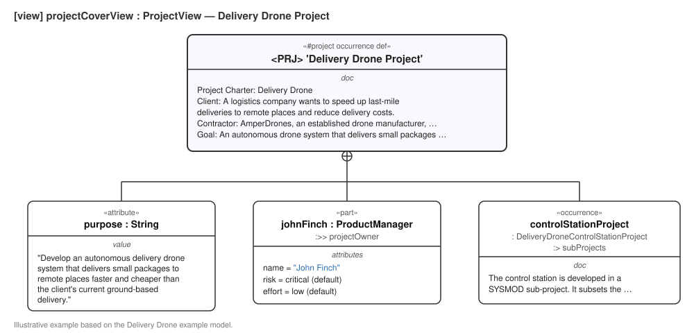

_Illustrative example based on the Delivery Drone example model ([projectView.svg](examples/views/projectView.svg))._

<a id="view-projectaiview"></a>

### ProjectAIView

Product "The Project" as an AI-generated management summary: a short markdown text with the project name, project owner, documentation, and purpose. It specializes ProjectView and replaces the tree diagram by the AI rendering asProjectFacts.

- **Specializes:** [ProjectView](#view-projectview)

**Backward traceability**

- **SYSMOD steps:** `SetupProject` (`'Delivery Drone Project'::projectCoverAIView`)
- **Viewpoints:** [ProjectViewpoint](#viewpoint-projectviewpoint) (inherited)
- **Concerns:** [ProjectStatus](#concern-projectstatus), [ProblemSolutionIntegration](#concern-problemsolutionintegration)
- **Stakeholders:** [ProjectManager](#stakeholder-projectmanager), [PortfolioManager](#stakeholder-portfoliomanager), [SystemArchitect](#stakeholder-systemarchitect)
- **ISO 15288 processes:** [Project Planning](#process-projectplanning), [Project Assessment and Control](#process-projectassessmentandcontrol), [Portfolio Management](#process-portfoliomanagement), [System Architecture Definition](#process-systemarchitecturedefinition)

**Dependencies**

- **Shows artifacts:** `Project` (inherited)
- **Created by:** `SetupProject`
- **Builds on:** —
- **Information provided:** `projectOwnerName`, `projectPurpose`
- **Traces to:** —
- **Input for:** —

**Definition**

```sysml
view def ProjectAIView :> ProjectView {
    doc /* Product "The Project" as an AI-generated management summary: a short markdown text with the project name,
            * project owner, documentation, and purpose. It specializes ProjectView and replaces the tree diagram
            * by the AI rendering asProjectFacts.
            */
    render asProjectFacts;
}
```

Rendering `asProjectFacts`: AI rendering that turns the exposed Project into markdown text. The create_prompt defines the structure: headline with the project name, the project owner, the documentation, and the purpose.

```sysml
rendering asProjectFacts : AIRendering :> Views::renderings {
    doc /* AI rendering that turns the exposed Project into markdown text. The create_prompt defines the structure:
            * headline with the project name, the project owner, the documentation, and the purpose.
            */
    :>> create_prompt = "Create pure text in markdown with a headline #Project <project name> and below 'Project owner: <project owner name>', and below ##Documentation, new line: <project doc>, and finally ##Purpose, new line <project purpose>.";
}
```

**Example**

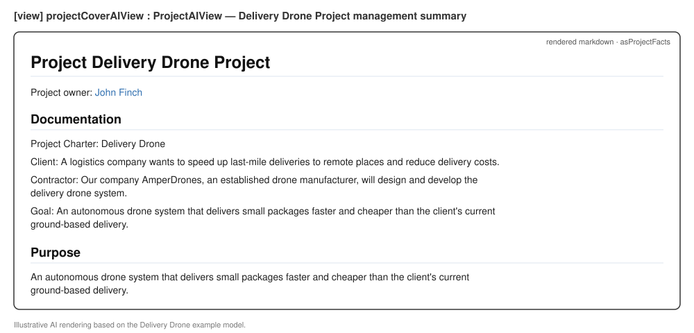

_Illustrative example based on the Delivery Drone example model ([projectAIView.svg](examples/views/projectAIView.svg))._

<a id="view-sysmodmapview"></a>

### SYSMODMapView

Product "The Project" as SYSMOD Map: the features of the exposed Project on one sheet with grid references, row A the concerns, row B the black box contexts, row C the white box contexts, and the columns 1 brownfield, 2 system idea, 3 specification, 4 functional, 5 logical, 6 product, and 7 verification and validation. It specializes ProjectView and replaces the tree diagram by the rendering asSYSMODMap. The status of a cell is the StepStatus of the step of the Project's defaultProcess that creates the cell's features.

- **Specializes:** [ProjectView](#view-projectview)

**Backward traceability**

- **SYSMOD steps:** `SetupProject` (`'Delivery Drone Project'::sysmodMapView`)
- **Viewpoints:** [ProjectViewpoint](#viewpoint-projectviewpoint) (inherited)
- **Concerns:** [ProjectStatus](#concern-projectstatus), [ProblemSolutionIntegration](#concern-problemsolutionintegration)
- **Stakeholders:** [ProjectManager](#stakeholder-projectmanager), [PortfolioManager](#stakeholder-portfoliomanager), [SystemArchitect](#stakeholder-systemarchitect)
- **ISO 15288 processes:** [Project Planning](#process-projectplanning), [Project Assessment and Control](#process-projectassessmentandcontrol), [Portfolio Management](#process-portfoliomanagement), [System Architecture Definition](#process-systemarchitecturedefinition)

**Dependencies**

- **Shows artifacts:** `Project` (inherited)
- **Created by:** `SetupProject`
- **Builds on:** —
- **Information provided:** `projectOwnerName`, `projectPurpose`
- **Traces to:** —
- **Input for:** —

**Definition**

```sysml
view def SYSMODMapView :> ProjectView {
    doc /* Product "The Project" as SYSMOD Map: the features of the exposed Project on one sheet with grid references,
            * row A the concerns, row B the black box contexts, row C the white box contexts, and the columns 1 brownfield,
            * 2 system idea, 3 specification, 4 functional, 5 logical, 6 product, and 7 verification and validation.
            * It specializes ProjectView and replaces the tree diagram by the rendering asSYSMODMap. The status of a cell
            * is the StepStatus of the step of the Project's defaultProcess that creates the cell's features.
            */
    render asSYSMODMap;
}
```

Rendering `asSYSMODMap`: Rendering of the exposed Project as SYSMOD Map. The cells, their Project features, and the steps that create them: Title block: purpose, projectOwner, defaultProcess, subProjects (setupProject). A1: problemStatement, projectStakeholders, stakeholderNeeds (specifyProblemStatement, identifyStakeholders, elaborateStakeholderNeeds). A2: systemObjectives (pitchSystemIdea). A3: systemRequirementSpecification (defineSystemSpecification). A4: #refinement dependencies from the functional elements to the system requirements (createFunctionalArchitecture). A5: #refinement dependencies from the logical elements to the system requirements (createLogicalArchitecture). A6: productSystemImpl satisfies systemRequirementSpecification (createProductArchitecture). A7: verificationContext.verificationCases (verifyAndValidateRequirements). B1: brownfieldContext; C1: brownfieldContextImpl (specifyBrownfieldSystem). B2: systemIdeaContext; C2: systemIdeaContextImpl (pitchSystemIdea). B3: specificationContext with the system use cases; C3: specificationContextImpl (defineSystemSpecification). B4: functionalContext; C4: functionalContextImpl (createFunctionalArchitecture). B5: logicalContext, functional2logical; C5: logicalContextImpl, functionalImpl2logicalImpl (createLogicalArchitecture). B6: productContext, logical2product; C6: productContextImpl, logicalImpl2productImpl (createProductArchitecture). B7 to C7: verificationContext (verifyAndValidateRequirements). Optional features the Project does not define, e.g., the functional context, are shown as empty cells.

```sysml
rendering asSYSMODMap :> Views::renderings {
    doc /* Rendering of the exposed Project as SYSMOD Map. The cells, their Project features, and the steps that create them:
            * Title block: purpose, projectOwner, defaultProcess, subProjects (setupProject).
            * A1: problemStatement, projectStakeholders, stakeholderNeeds (specifyProblemStatement, identifyStakeholders, elaborateStakeholderNeeds).
            * A2: systemObjectives (pitchSystemIdea).
            * A3: systemRequirementSpecification (defineSystemSpecification).
            * A4: #refinement dependencies from the functional elements to the system requirements (createFunctionalArchitecture).
            * A5: #refinement dependencies from the logical elements to the system requirements (createLogicalArchitecture).
            * A6: productSystemImpl satisfies systemRequirementSpecification (createProductArchitecture).
            * A7: verificationContext.verificationCases (verifyAndValidateRequirements).
            * B1: brownfieldContext; C1: brownfieldContextImpl (specifyBrownfieldSystem).
            * B2: systemIdeaContext; C2: systemIdeaContextImpl (pitchSystemIdea).
            * B3: specificationContext with the system use cases; C3: specificationContextImpl (defineSystemSpecification).
            * B4: functionalContext; C4: functionalContextImpl (createFunctionalArchitecture).
            * B5: logicalContext, functional2logical; C5: logicalContextImpl, functionalImpl2logicalImpl (createLogicalArchitecture).
            * B6: productContext, logical2product; C6: productContextImpl, logicalImpl2productImpl (createProductArchitecture).
            * B7 to C7: verificationContext (verifyAndValidateRequirements).
            * Optional features the Project does not define, e.g., the functional context, are shown as empty cells.
            */
}
```

**Example**

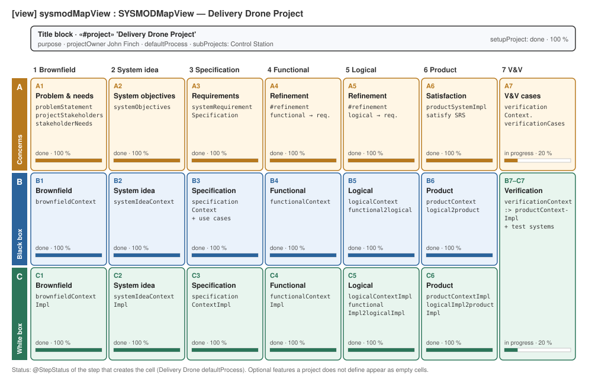

_Illustrative example based on the Delivery Drone example model ([sysmodMapView.svg](examples/views/sysmodMapView.svg))._

<a id="view-problemstatementview"></a>

### ProblemStatementView

Product "Problem Statement": the problemStatement of the Project with its projectOwner as stakeholder and the brownfield system as subject.

- **Specializes:** `GeneralView`
- **Specialized by:** [ProblemStatementAIView](#view-problemstatementaiview)

**Backward traceability**

- **SYSMOD steps:** `SpecifyProblemStatement` (`'Delivery Drone Project'::problemStatementView`)
- **Viewpoints:** [ProblemSolutionViewpoint](#viewpoint-problemsolutionviewpoint)
- **Concerns:** [ProblemSolutionPitch](#concern-problemsolutionpitch), [MissionGoalsAndMeasures](#concern-missiongoalsandmeasures)
- **Stakeholders:** [ProductManager](#stakeholder-productmanager), [Acquirer](#stakeholder-acquirer)
- **ISO 15288 processes:** [Business or Mission Analysis](#process-businessormissionanalysis), [Acquisition](#process-acquisition)

**Dependencies**

- **Shows artifacts:** `problemStatement`
- **Created by:** `SpecifyProblemStatement`
- **Builds on:** [ProjectView](#view-projectview) (`Project`), [BrownfieldArchitectureView](#view-brownfieldarchitectureview) (`brownfieldContextImpl`)
- **Information provided:** `problemStatementText`
- **Traces to:** [BrownfieldArchitectureView](#view-brownfieldarchitectureview) (problemStatement has its subject in brownfieldContextImpl)
- **Input for:** [StakeholdersView](#view-stakeholdersview), [StakeholderNeedsView](#view-stakeholderneedsview), [SystemIdeaView](#view-systemideaview), [SystemObjectivesView](#view-systemobjectivesview)

**Definition**

```sysml
view def ProblemStatementView :> StandardViewDefinitions::GeneralView {
    doc /* Product "Problem Statement": the problemStatement of the Project with its projectOwner as stakeholder
            * and the brownfield system as subject.
            */
    satisfy requirement psvp : ProblemSolutionViewpoint;
    filter @SysML::ConcernUsage and (as SysML::ConcernUsage).name == "problemStatement";
    render Views::asTreeDiagram;
}
```

**Example**

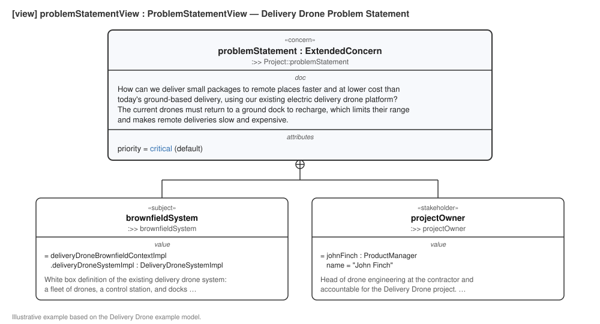

_Illustrative example based on the Delivery Drone example model ([problemStatementView.svg](examples/views/problemStatementView.svg))._

<a id="view-problemstatementaiview"></a>

### ProblemStatementAIView

Product "Problem Statement" as an AI-generated summary: a short markdown text with the problem statement, project owner, and brownfield system.

- **Specializes:** [ProblemStatementView](#view-problemstatementview)

**Backward traceability**

- **SYSMOD steps:** `SpecifyProblemStatement` (`'Delivery Drone Project'::problemStatementAIView`)
- **Viewpoints:** [ProblemSolutionViewpoint](#viewpoint-problemsolutionviewpoint) (inherited)
- **Concerns:** [ProblemSolutionPitch](#concern-problemsolutionpitch), [MissionGoalsAndMeasures](#concern-missiongoalsandmeasures)
- **Stakeholders:** [ProductManager](#stakeholder-productmanager), [Acquirer](#stakeholder-acquirer)
- **ISO 15288 processes:** [Business or Mission Analysis](#process-businessormissionanalysis), [Acquisition](#process-acquisition)

**Dependencies**

- **Shows artifacts:** `problemStatement` (inherited)
- **Created by:** `SpecifyProblemStatement`
- **Builds on:** [ProjectView](#view-projectview) (`Project`), [BrownfieldArchitectureView](#view-brownfieldarchitectureview) (`brownfieldContextImpl`)
- **Information provided:** `problemStatementText`
- **Traces to:** [BrownfieldArchitectureView](#view-brownfieldarchitectureview) (problemStatement has its subject in brownfieldContextImpl)
- **Input for:** —

**Definition**

```sysml
view def ProblemStatementAIView :> ProblemStatementView {
    doc /* Product "Problem Statement" as an AI-generated summary: a short markdown text with the problem statement, project owner, and brownfield system. */
    render asMarkdown {
        :>> title = "Problem Statement";
    }
}
```

Rendering `asMarkdown`: AI rendering that turns the exposed Problem Statement into markdown text. The create_prompt defines the structure: headline with the problem statement, the project owner, and the brownfield system.

```sysml
rendering asMarkdown : AIRendering :> Views::renderings {
    doc /* AI rendering that turns the exposed Problem Statement into markdown text. The create_prompt defines the structure:
            * headline with the problem statement, the project owner, and the brownfield system.
            */
    attribute title : ScalarValues::String;
    :>> create_prompt = "Create pure text in markdown with a headline <title>, and below the exposed element as text.";
}
```

**Example**

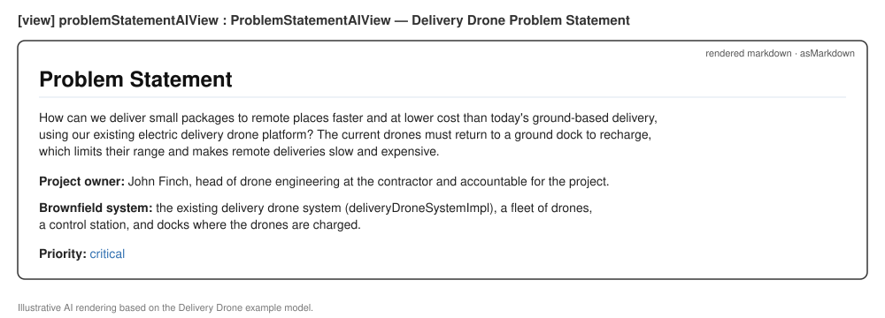

_Illustrative example based on the Delivery Drone example model ([problemStatementAIView.svg](examples/views/problemStatementAIView.svg))._

<a id="view-stakeholdersview"></a>

### StakeholdersView

Product "Stakeholders": the projectStakeholders with their risk, effort, attention, and categories.

- **Specializes:** `GridView`

**Backward traceability**

- **SYSMOD steps:** —
- **Viewpoints:** [RequirementsViewpoint](#viewpoint-requirementsviewpoint)
- **Concerns:** [StakeholderNeedsCoverage](#concern-stakeholderneedscoverage)
- **Stakeholders:** [RequirementsEngineer](#stakeholder-requirementsengineer), [ProductManager](#stakeholder-productmanager)
- **ISO 15288 processes:** [Stakeholder Needs and Requirements Definition](#process-stakeholderneedsandrequirementsdefinition), [System Requirements Definition](#process-systemrequirementsdefinition), [Business or Mission Analysis](#process-businessormissionanalysis)

**Dependencies**

- **Shows artifacts:** `projectStakeholders`
- **Created by:** `IdentifyStakeholders`
- **Builds on:** [ProblemStatementView](#view-problemstatementview) (`problemStatement`)
- **Information provided:** —
- **Traces to:** —
- **Input for:** [StakeholderNeedsView](#view-stakeholderneedsview)

**Definition**

```sysml
view def StakeholdersView :> StandardViewDefinitions::GridView {
    doc /* Product "Stakeholders": the projectStakeholders with their risk, effort, attention, and categories. */
    satisfy requirement rvp : RequirementsViewpoint;
    filter @StakeholderMetadata;
    render Views::asElementTable;
}
```

**Example**

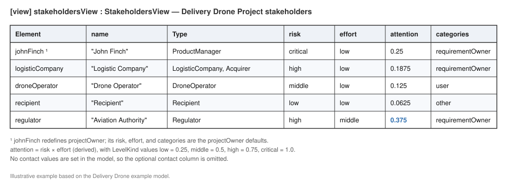

_Illustrative example based on the Delivery Drone example model ([stakeholdersView.svg](examples/views/stakeholdersView.svg))._

<a id="view-stakeholderneedsview"></a>

### StakeholderNeedsView

Product "Stakeholder Needs": the stakeholderNeeds of the Project, framed by the problemStatement and traced to the projectStakeholders they come from.

- **Specializes:** `GeneralView`

**Backward traceability**

- **SYSMOD steps:** —
- **Viewpoints:** [RequirementsViewpoint](#viewpoint-requirementsviewpoint)
- **Concerns:** [StakeholderNeedsCoverage](#concern-stakeholderneedscoverage)
- **Stakeholders:** [RequirementsEngineer](#stakeholder-requirementsengineer), [ProductManager](#stakeholder-productmanager)
- **ISO 15288 processes:** [Stakeholder Needs and Requirements Definition](#process-stakeholderneedsandrequirementsdefinition), [System Requirements Definition](#process-systemrequirementsdefinition), [Business or Mission Analysis](#process-businessormissionanalysis)

**Dependencies**

- **Shows artifacts:** `stakeholderNeeds`
- **Created by:** `ElaborateStakeholderNeeds`
- **Builds on:** [ProblemStatementView](#view-problemstatementview) (`problemStatement`), [StakeholdersView](#view-stakeholdersview) (`projectStakeholders`)
- **Information provided:** —
- **Traces to:** [ProblemStatementView](#view-problemstatementview) (stakeholderNeeds frames problemStatement), [BrownfieldArchitectureView](#view-brownfieldarchitectureview) (stakeholderNeeds has its subject in brownfieldContextImpl)
- **Input for:** [SystemIdeaView](#view-systemideaview), [SystemObjectivesView](#view-systemobjectivesview), [UseCasesView](#view-usecasesview), [UseCaseFlowView](#view-usecaseflowview), [SystemRequirementsView](#view-systemrequirementsview)

**Definition**

```sysml
view def StakeholderNeedsView :> StandardViewDefinitions::GeneralView {
    doc /* Product "Stakeholder Needs": the stakeholderNeeds of the Project, framed by the problemStatement
            * and traced to the projectStakeholders they come from.
            */
    satisfy requirement rvp : RequirementsViewpoint;
    filter @SysML::ConcernUsage or @ExtendedConcernMetadata or @StakeholderMetadata;
    render Views::asTreeDiagram;
}
```

**Example**

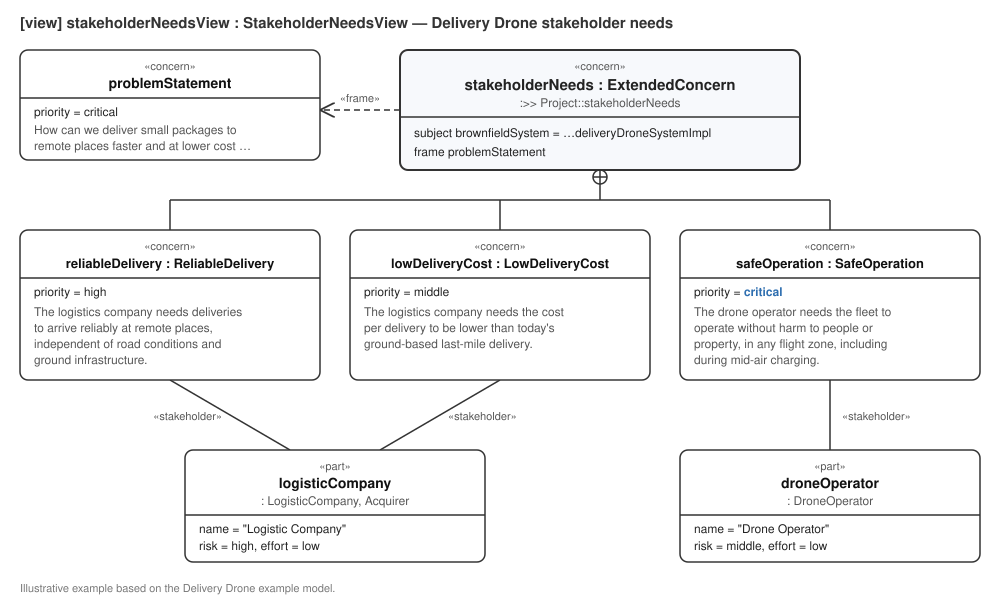

_Illustrative example based on the Delivery Drone example model ([stakeholderNeedsView.svg](examples/views/stakeholderNeedsView.svg))._

<a id="view-brownfieldarchitectureview"></a>

### BrownfieldArchitectureView

Product "The Brownfield Architecture": the brownfieldContext and brownfieldContextImpl of the Project, i.e., the existing system of interest with its actors, ports, and actorSystemInterfaces.

- **Specializes:** [SystemContextView](#view-systemcontextview)

**Backward traceability**

- **SYSMOD steps:** —
- **Viewpoints:** [InterfaceViewpoint](#viewpoint-interfaceviewpoint)
- **Concerns:** [InterfaceIntegration](#concern-interfaceintegration)
- **Stakeholders:** [IntegrationEngineer](#stakeholder-integrationengineer), [DesignEngineer](#stakeholder-designengineer)
- **ISO 15288 processes:** [Integration](#process-integration), [Design Definition](#process-designdefinition), [Implementation](#process-implementation)

**Dependencies**

- **Shows artifacts:** `brownfieldContext`, `brownfieldContextImpl`
- **Created by:** `SpecifyBrownfieldSystem`
- **Builds on:** —
- **Information provided:** `brownfieldArchitecture`
- **Traces to:** —
- **Input for:** [ProblemStatementView](#view-problemstatementview)

**Definition**

```sysml
view def BrownfieldArchitectureView :> SystemContextView {
    doc /* Product "The Brownfield Architecture": the brownfieldContext and brownfieldContextImpl of the Project,
            * i.e., the existing system of interest with its actors, ports, and actorSystemInterfaces.
            */
    satisfy requirement ivp : InterfaceViewpoint;
}
```

**Example**

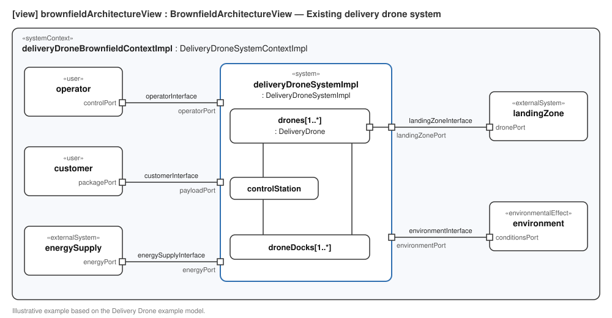

_Illustrative example based on the Delivery Drone example model ([brownfieldArchitectureView.svg](examples/views/brownfieldArchitectureView.svg))._

<a id="view-systemideaview"></a>

### SystemIdeaView

Product "The System Idea": the systemIdeaContext and systemIdeaContextImpl of the Project that answer the problemStatement.

- **Specializes:** [SystemContextView](#view-systemcontextview)

**Backward traceability**

- **SYSMOD steps:** —
- **Viewpoints:** [ProblemSolutionViewpoint](#viewpoint-problemsolutionviewpoint)
- **Concerns:** [ProblemSolutionPitch](#concern-problemsolutionpitch), [MissionGoalsAndMeasures](#concern-missiongoalsandmeasures)
- **Stakeholders:** [ProductManager](#stakeholder-productmanager), [Acquirer](#stakeholder-acquirer)
- **ISO 15288 processes:** [Business or Mission Analysis](#process-businessormissionanalysis), [Acquisition](#process-acquisition)

**Dependencies**

- **Shows artifacts:** `systemIdeaContext`, `systemIdeaContextImpl`
- **Created by:** `PitchSystemIdea`
- **Builds on:** [ProblemStatementView](#view-problemstatementview) (`problemStatement`), [StakeholderNeedsView](#view-stakeholderneedsview) (`stakeholderNeeds`)
- **Information provided:** `systemIdeaArchitecture`
- **Traces to:** [BrownfieldArchitectureView](#view-brownfieldarchitectureview) (systemIdeaContext specializes brownfieldContext; systemIdeaContextImpl specializes brownfieldContextImpl), [ProblemStatementView](#view-problemstatementview) (systemIdeaContextImpl satisfies problemStatement)
- **Input for:** [SpecificationSystemView](#view-specificationsystemview)

**Definition**

```sysml
view def SystemIdeaView :> SystemContextView {
    doc /* Product "The System Idea": the systemIdeaContext and systemIdeaContextImpl of the Project
            * that answer the problemStatement.
            */
    satisfy requirement psvp : ProblemSolutionViewpoint;
}
```

**Example**

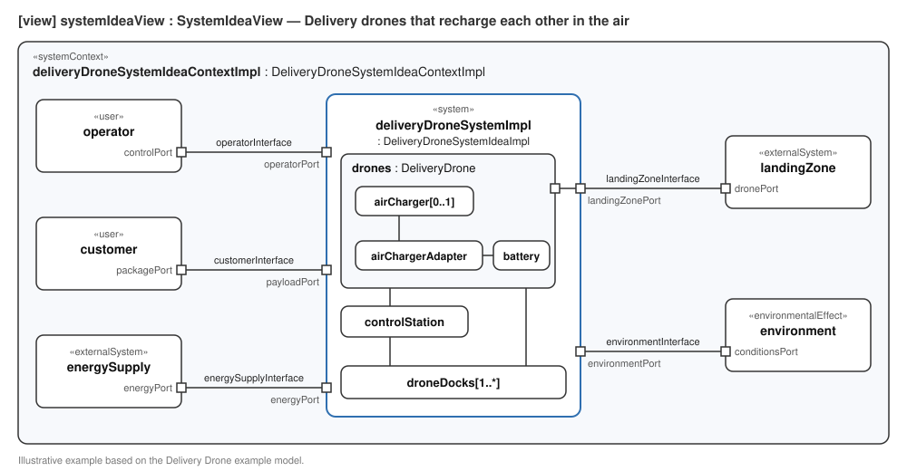

_Illustrative example based on the Delivery Drone example model ([systemIdeaView.svg](examples/views/systemIdeaView.svg))._

<a id="view-systemobjectivesview"></a>

### SystemObjectivesView

Product "The System Idea": the systemObjectives of the Project, i.e., the measurable goals of the system idea that direct the development, with the projectOwner as stakeholder, the system idea as subject, and the stakeholderNeeds they frame.

- **Specializes:** `GeneralView`

**Backward traceability**

- **SYSMOD steps:** `PitchSystemIdea` (`'Delivery Drone Project'::systemObjectivesView`)
- **Viewpoints:** [ProblemSolutionViewpoint](#viewpoint-problemsolutionviewpoint)
- **Concerns:** [ProblemSolutionPitch](#concern-problemsolutionpitch), [MissionGoalsAndMeasures](#concern-missiongoalsandmeasures)
- **Stakeholders:** [ProductManager](#stakeholder-productmanager), [Acquirer](#stakeholder-acquirer)
- **ISO 15288 processes:** [Business or Mission Analysis](#process-businessormissionanalysis), [Acquisition](#process-acquisition)

**Dependencies**

- **Shows artifacts:** `systemObjectives`
- **Created by:** `PitchSystemIdea`
- **Builds on:** [ProblemStatementView](#view-problemstatementview) (`problemStatement`), [StakeholderNeedsView](#view-stakeholderneedsview) (`stakeholderNeeds`)
- **Information provided:** `systemIdeaArchitecture`
- **Traces to:** [StakeholderNeedsView](#view-stakeholderneedsview) (systemObjectives frames stakeholderNeeds), [SystemIdeaView](#view-systemideaview) (systemObjectives has its subject in systemIdeaContext)
- **Input for:** [SystemRequirementsView](#view-systemrequirementsview)

**Definition**

```sysml
view def SystemObjectivesView :> StandardViewDefinitions::GeneralView {
    doc /* Product "The System Idea": the systemObjectives of the Project, i.e., the measurable goals of the system idea
            * that direct the development, with the projectOwner as stakeholder, the system idea as subject,
            * and the stakeholderNeeds they frame.
            */
    satisfy requirement psvp : ProblemSolutionViewpoint;
    filter @SysML::ConcernUsage;
    render Views::asTreeDiagram;
}
```

**Example**

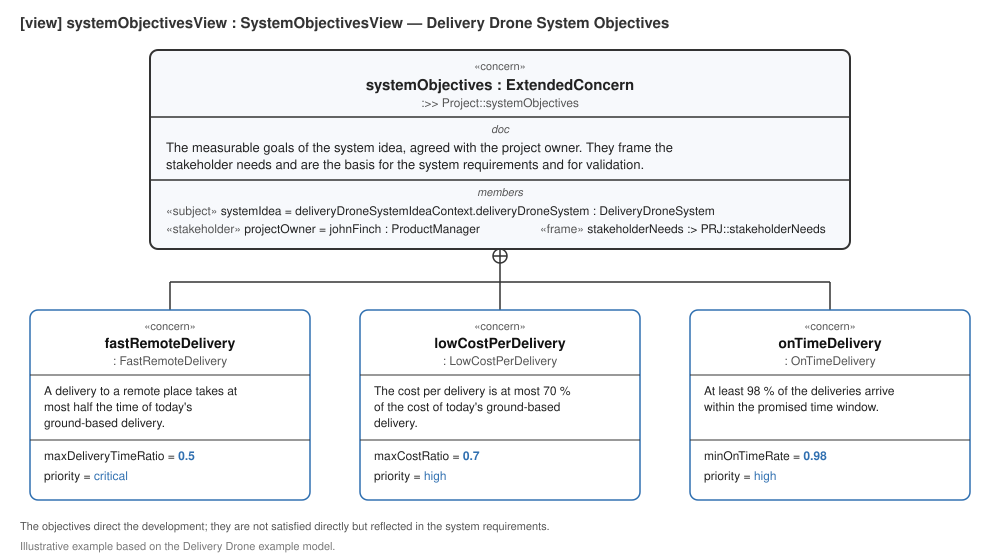

_Illustrative example based on the Delivery Drone example model ([systemObjectivesView.svg](examples/views/systemObjectivesView.svg))._

<a id="view-specificationsystemview"></a>

### SpecificationSystemView

Product "The Specification System": the specificationContext of the Project that defines the system boundary with the actors, the system ports, and the actorSystemInterfaces.

- **Specializes:** [SystemContextView](#view-systemcontextview)

**Backward traceability**

- **SYSMOD steps:** —
- **Viewpoints:** [InterfaceViewpoint](#viewpoint-interfaceviewpoint)
- **Concerns:** [InterfaceIntegration](#concern-interfaceintegration)
- **Stakeholders:** [IntegrationEngineer](#stakeholder-integrationengineer), [DesignEngineer](#stakeholder-designengineer)
- **ISO 15288 processes:** [Integration](#process-integration), [Design Definition](#process-designdefinition), [Implementation](#process-implementation)

**Dependencies**

- **Shows artifacts:** `specificationContext`, `specificationContextImpl`
- **Created by:** `DefineSystemSpecification`
- **Builds on:** [SystemIdeaView](#view-systemideaview) (`systemIdeaContextImpl`)
- **Information provided:** —
- **Traces to:** [SystemIdeaView](#view-systemideaview) (specificationContext specializes systemIdeaContext; specificationContextImpl specializes systemIdeaContextImpl)
- **Input for:** [UseCasesView](#view-usecasesview), [UseCaseFlowView](#view-usecaseflowview), [SystemRequirementsView](#view-systemrequirementsview), [FunctionalArchitectureView](#view-functionalarchitectureview), [LogicalArchitectureView](#view-logicalarchitectureview), [ProductArchitectureView](#view-productarchitectureview), [ArchitectureAllocationView](#view-architectureallocationview)

**Definition**

```sysml
view def SpecificationSystemView :> SystemContextView {
    doc /* Product "The Specification System": the specificationContext of the Project that defines
            * the system boundary with the actors, the system ports, and the actorSystemInterfaces.
            */
    satisfy requirement ivp : InterfaceViewpoint;
}
```

**Example**

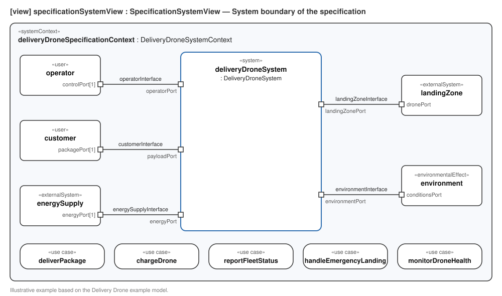

_Illustrative example based on the Delivery Drone example model ([specificationSystemView.svg](examples/views/specificationSystemView.svg))._

<a id="view-usecasesview"></a>

### UseCasesView

Product "Use Cases": the system use cases of the specificationContext with their actors and subject.

- **Specializes:** `GeneralView`

**Backward traceability**

- **SYSMOD steps:** —
- **Viewpoints:** [UseCaseViewpoint](#viewpoint-usecaseviewpoint)
- **Concerns:** [SystemOperation](#concern-systemoperation)
- **Stakeholders:** [Operator](#stakeholder-operator)
- **ISO 15288 processes:** [Operation](#process-operation)

**Dependencies**

- **Shows artifacts:** `specificationContext.useCases`
- **Created by:** `DefineSystemSpecification`
- **Builds on:** [StakeholderNeedsView](#view-stakeholderneedsview) (`stakeholderNeeds`), [SpecificationSystemView](#view-specificationsystemview) (`specificationContextImpl`)
- **Information provided:** —
- **Traces to:** —
- **Input for:** —

**Definition**

```sysml
view def UseCasesView :> StandardViewDefinitions::GeneralView {
    doc /* Product "Use Cases": the system use cases of the specificationContext with their actors and subject. */
    satisfy requirement ucvp : UseCaseViewpoint;
    filter @SystemUseCaseMetadata or @SecondaryUsageCaseMetadata or @SystemProcessMetadata or @ContinuousUseCaseMetadata
        or @SysML::UseCaseUsage or @system or @user or @externalSystem or @environmentalEffect;
    render Views::asTreeDiagram;
}
```

**Example**

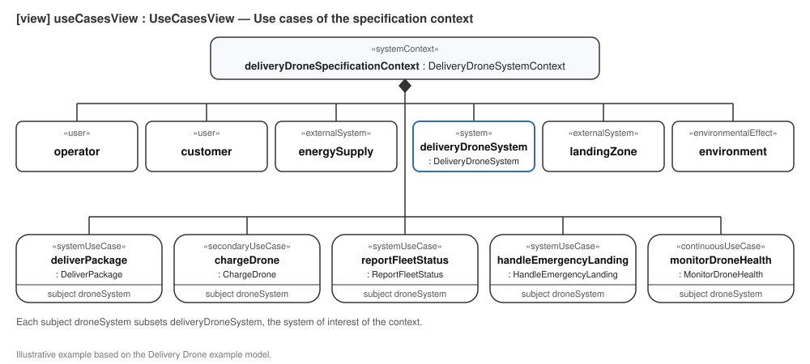

_Illustrative example based on the Delivery Drone example model ([useCasesView.svg](examples/views/useCasesView.svg))._

<a id="view-usecaseflowview"></a>

### UseCaseFlowView

Product "Use Cases": the flow of a single system use case, step by step.

- **Specializes:** `ActionFlowView`

**Backward traceability**

- **SYSMOD steps:** —
- **Viewpoints:** [UseCaseViewpoint](#viewpoint-usecaseviewpoint)
- **Concerns:** [SystemOperation](#concern-systemoperation)
- **Stakeholders:** [Operator](#stakeholder-operator)
- **ISO 15288 processes:** [Operation](#process-operation)

**Dependencies**

- **Shows artifacts:** `specificationContext.useCases`
- **Created by:** `DefineSystemSpecification`
- **Builds on:** [StakeholderNeedsView](#view-stakeholderneedsview) (`stakeholderNeeds`), [SpecificationSystemView](#view-specificationsystemview) (`specificationContextImpl`)
- **Information provided:** —
- **Traces to:** —
- **Input for:** —

**Definition**

```sysml
view def UseCaseFlowView :> StandardViewDefinitions::ActionFlowView {
    doc /* Product "Use Cases": the flow of a single system use case, step by step. */
    satisfy requirement ucvp : UseCaseViewpoint;
}
```

**Example**

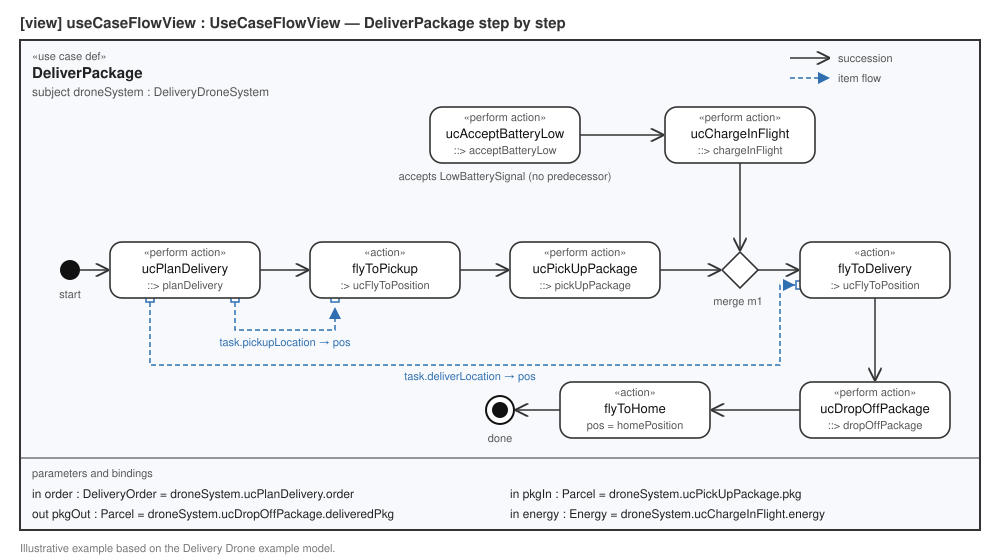

_Illustrative example based on the Delivery Drone example model ([useCaseFlowView.svg](examples/views/useCaseFlowView.svg))._

<a id="view-systemrequirementsview"></a>

### SystemRequirementsView

Product "System Requirements": the systemRequirementSpecification of the Project with the system requirements that frame the stakeholderNeeds.

- **Specializes:** `GridView`

**Backward traceability**

- **SYSMOD steps:** —
- **Viewpoints:** [RequirementsViewpoint](#viewpoint-requirementsviewpoint)
- **Concerns:** [StakeholderNeedsCoverage](#concern-stakeholderneedscoverage)
- **Stakeholders:** [RequirementsEngineer](#stakeholder-requirementsengineer), [ProductManager](#stakeholder-productmanager)
- **ISO 15288 processes:** [Stakeholder Needs and Requirements Definition](#process-stakeholderneedsandrequirementsdefinition), [System Requirements Definition](#process-systemrequirementsdefinition), [Business or Mission Analysis](#process-businessormissionanalysis)

**Dependencies**

- **Shows artifacts:** `systemRequirementSpecification`
- **Created by:** `DefineSystemSpecification`
- **Builds on:** [StakeholderNeedsView](#view-stakeholderneedsview) (`stakeholderNeeds`), [SystemObjectivesView](#view-systemobjectivesview) (`systemObjectives`), [SpecificationSystemView](#view-specificationsystemview) (`specificationContextImpl`)
- **Information provided:** —
- **Traces to:** [StakeholderNeedsView](#view-stakeholderneedsview) (systemRequirementSpecification frames stakeholderNeeds), [SpecificationSystemView](#view-specificationsystemview) (systemRequirementSpecification has its subject in specificationContext)
- **Input for:** [VerificationAndValidationView](#view-verificationandvalidationview), [VerificationMatrixView](#view-verificationmatrixview)

**Definition**

```sysml
view def SystemRequirementsView :> StandardViewDefinitions::GridView {
    doc /* Product "System Requirements": the systemRequirementSpecification of the Project
            * with the system requirements that frame the stakeholderNeeds.
            */
    satisfy requirement rvp : RequirementsViewpoint;
    filter @ExtendedRequirementMetadata or @SysML::RequirementUsage;
    render Views::asElementTable;
}
```

**Example**

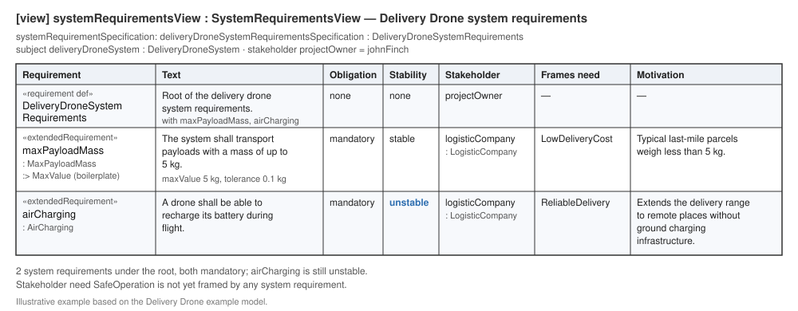

_Illustrative example based on the Delivery Drone example model ([systemRequirementsView.svg](examples/views/systemRequirementsView.svg))._

<a id="view-solutionarchitectureview"></a>

### SolutionArchitectureView (abstract)

Product "Functional, Logical, Product Architecture": base view for the solution architectures.

- **Specializes:** `InterconnectionView`
- **Specialized by:** [FunctionalArchitectureView](#view-functionalarchitectureview), [LogicalArchitectureView](#view-logicalarchitectureview), [ProductArchitectureView](#view-productarchitectureview)

**Backward traceability**

- **SYSMOD steps:** —
- **Viewpoints:** [ArchitectureViewpoint](#viewpoint-architectureviewpoint)
- **Concerns:** [ProblemSolutionIntegration](#concern-problemsolutionintegration), [DesignConsistency](#concern-designconsistency)
- **Stakeholders:** [SystemArchitect](#stakeholder-systemarchitect), [DesignEngineer](#stakeholder-designengineer)
- **ISO 15288 processes:** [System Architecture Definition](#process-systemarchitecturedefinition), [Design Definition](#process-designdefinition), [Implementation](#process-implementation)

**Dependencies**

_Not tied to Project artifacts; the view shows whatever a project exposes, see its specializations._

**Definition**

```sysml
abstract view def SolutionArchitectureView :> StandardViewDefinitions::InterconnectionView {
    doc /* Product "Functional, Logical, Product Architecture": base view for the solution architectures. */
    satisfy requirement avp : ArchitectureViewpoint;
    filter @SystemContextMetadata or @system or @SysML::PartUsage or @SysML::PortUsage
        or @SysML::InterfaceUsage or @SysML::ConnectionUsage;
    filter not (@KerML::Element::isLibraryElement);
    render Views::asInterconnectionDiagram;
}
```

**Example**

Abstract view definition; see the examples of [FunctionalArchitectureView](#view-functionalarchitectureview), [LogicalArchitectureView](#view-logicalarchitectureview), [ProductArchitectureView](#view-productarchitectureview).

<a id="view-functionalarchitectureview"></a>

### FunctionalArchitectureView

The functionalContext and functionalContextImpl of the Project with the functional blocks of the functional system.

- **Specializes:** [SolutionArchitectureView](#view-solutionarchitectureview)

**Backward traceability**

- **SYSMOD steps:** —
- **Viewpoints:** [ArchitectureViewpoint](#viewpoint-architectureviewpoint) (inherited)
- **Concerns:** [ProblemSolutionIntegration](#concern-problemsolutionintegration), [DesignConsistency](#concern-designconsistency)
- **Stakeholders:** [SystemArchitect](#stakeholder-systemarchitect), [DesignEngineer](#stakeholder-designengineer)
- **ISO 15288 processes:** [System Architecture Definition](#process-systemarchitecturedefinition), [Design Definition](#process-designdefinition), [Implementation](#process-implementation)

**Dependencies**

- **Shows artifacts:** `functionalContext`, `functionalContextImpl`
- **Created by:** `CreateFunctionalArchitecture`
- **Builds on:** [SpecificationSystemView](#view-specificationsystemview) (`specificationContext`)
- **Information provided:** `functionalArchitecture`
- **Traces to:** [SpecificationSystemView](#view-specificationsystemview) (functionalContext specializes specificationContext)
- **Input for:** [LogicalArchitectureView](#view-logicalarchitectureview), [ProductArchitectureView](#view-productarchitectureview), [ArchitectureAllocationView](#view-architectureallocationview)

**Definition**

```sysml
view def FunctionalArchitectureView :> SolutionArchitectureView {
    doc /* The functionalContext and functionalContextImpl of the Project with the functional blocks of the functional system. */
}
```

**Example**

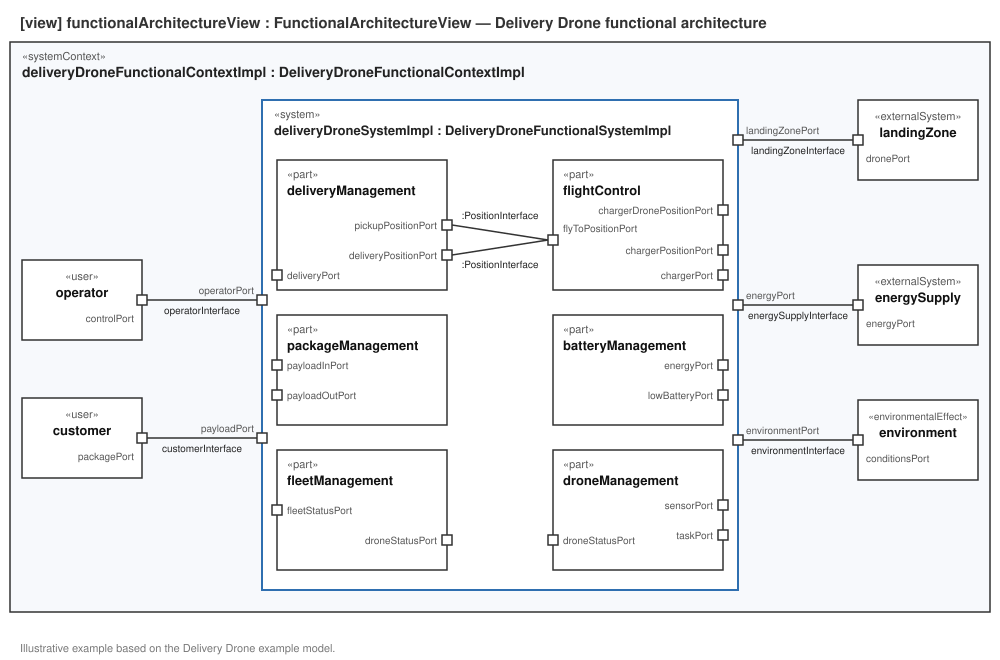

_Illustrative example based on the Delivery Drone example model ([functionalArchitectureView.svg](examples/views/functionalArchitectureView.svg))._

<a id="view-logicalarchitectureview"></a>

### LogicalArchitectureView

The logicalContext and logicalContextImpl of the Project with the technology-independent building blocks of the logical system.

- **Specializes:** [SolutionArchitectureView](#view-solutionarchitectureview)

**Backward traceability**

- **SYSMOD steps:** —
- **Viewpoints:** [ArchitectureViewpoint](#viewpoint-architectureviewpoint) (inherited)
- **Concerns:** [ProblemSolutionIntegration](#concern-problemsolutionintegration), [DesignConsistency](#concern-designconsistency)
- **Stakeholders:** [SystemArchitect](#stakeholder-systemarchitect), [DesignEngineer](#stakeholder-designengineer)
- **ISO 15288 processes:** [System Architecture Definition](#process-systemarchitecturedefinition), [Design Definition](#process-designdefinition), [Implementation](#process-implementation)

**Dependencies**

- **Shows artifacts:** `logicalContext`, `logicalContextImpl`
- **Created by:** `CreateLogicalArchitecture`
- **Builds on:** [SpecificationSystemView](#view-specificationsystemview) (`specificationContextImpl`), [FunctionalArchitectureView](#view-functionalarchitectureview) (`functionalContext`, `functionalContextImpl`)
- **Information provided:** `logicalArchitecture`
- **Traces to:** [SpecificationSystemView](#view-specificationsystemview) (logicalContext specializes specificationContext; logicalContextImpl specializes specificationContextImpl)
- **Input for:** [ProductArchitectureView](#view-productarchitectureview), [ArchitectureAllocationView](#view-architectureallocationview)

**Definition**

```sysml
view def LogicalArchitectureView :> SolutionArchitectureView {
    doc /* The logicalContext and logicalContextImpl of the Project with the technology-independent building blocks of the logical system. */
}
```

**Example**

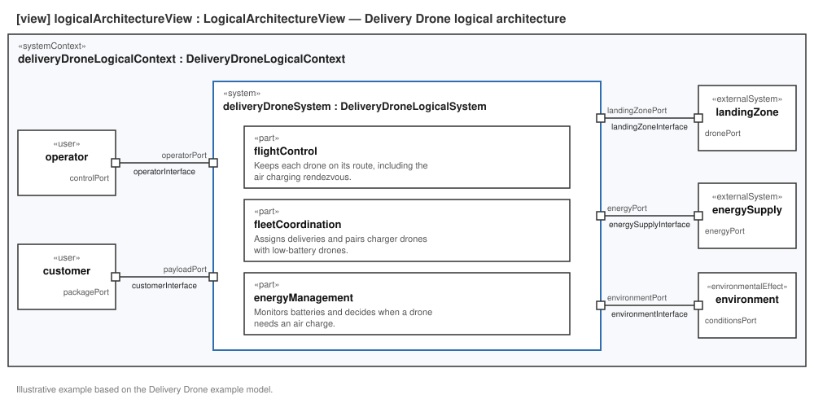

_Illustrative example based on the Delivery Drone example model ([logicalArchitectureView.svg](examples/views/logicalArchitectureView.svg))._

<a id="view-productarchitectureview"></a>

### ProductArchitectureView

The productContext and productContextImpl of the Project with the concrete building blocks of the product system.

- **Specializes:** [SolutionArchitectureView](#view-solutionarchitectureview)

**Backward traceability**

- **SYSMOD steps:** —
- **Viewpoints:** [ArchitectureViewpoint](#viewpoint-architectureviewpoint) (inherited)
- **Concerns:** [ProblemSolutionIntegration](#concern-problemsolutionintegration), [DesignConsistency](#concern-designconsistency)
- **Stakeholders:** [SystemArchitect](#stakeholder-systemarchitect), [DesignEngineer](#stakeholder-designengineer)
- **ISO 15288 processes:** [System Architecture Definition](#process-systemarchitecturedefinition), [Design Definition](#process-designdefinition), [Implementation](#process-implementation)

**Dependencies**

- **Shows artifacts:** `productContext`, `productContextImpl`
- **Created by:** `CreateProductArchitecture`
- **Builds on:** [SpecificationSystemView](#view-specificationsystemview) (`specificationContextImpl`), [FunctionalArchitectureView](#view-functionalarchitectureview) (`functionalContextImpl`), [LogicalArchitectureView](#view-logicalarchitectureview) (`logicalContext`, `logicalContextImpl`)
- **Information provided:** `productArchitecture`
- **Traces to:** [SpecificationSystemView](#view-specificationsystemview) (productContext specializes specificationContext; productContextImpl specializes specificationContextImpl), [SystemRequirementsView](#view-systemrequirementsview) (productContextImpl satisfies systemRequirementSpecification)
- **Input for:** [VerificationAndValidationView](#view-verificationandvalidationview), [VerificationMatrixView](#view-verificationmatrixview)

**Definition**

```sysml
view def ProductArchitectureView :> SolutionArchitectureView {
    doc /* The productContext and productContextImpl of the Project with the concrete building blocks of the product system. */
}
```

**Example**

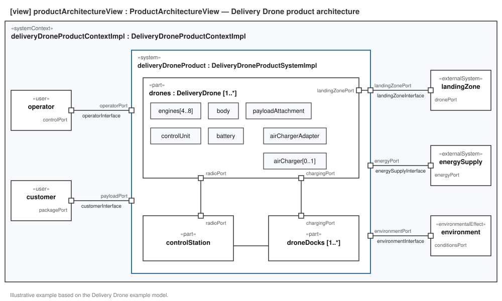

_Illustrative example based on the Delivery Drone example model ([productArchitectureView.svg](examples/views/productArchitectureView.svg))._

<a id="view-architectureallocationview"></a>

### ArchitectureAllocationView

The allocations functional2logical, logical2product, functionalImpl2logicalImpl, and logicalImpl2productImpl between the solution architectures.

- **Specializes:** `GridView`

**Backward traceability**

- **SYSMOD steps:** —
- **Viewpoints:** [ArchitectureViewpoint](#viewpoint-architectureviewpoint)
- **Concerns:** [ProblemSolutionIntegration](#concern-problemsolutionintegration), [DesignConsistency](#concern-designconsistency)
- **Stakeholders:** [SystemArchitect](#stakeholder-systemarchitect), [DesignEngineer](#stakeholder-designengineer)
- **ISO 15288 processes:** [System Architecture Definition](#process-systemarchitecturedefinition), [Design Definition](#process-designdefinition), [Implementation](#process-implementation)

**Dependencies**

- **Shows artifacts:** `functional2logical`, `logical2product`, `functionalImpl2logicalImpl`, `logicalImpl2productImpl`
- **Created by:** `CreateLogicalArchitecture`, `CreateProductArchitecture`
- **Builds on:** [SpecificationSystemView](#view-specificationsystemview) (`specificationContextImpl`), [FunctionalArchitectureView](#view-functionalarchitectureview) (`functionalContext`, `functionalContextImpl`), [LogicalArchitectureView](#view-logicalarchitectureview) (`logicalContext`, `logicalContextImpl`)
- **Information provided:** `logicalArchitecture`, `productArchitecture`
- **Traces to:** [FunctionalArchitectureView](#view-functionalarchitectureview) (functional2logical allocates functionalContext; functionalImpl2logicalImpl allocates functionalContextImpl), [LogicalArchitectureView](#view-logicalarchitectureview) (functional2logical allocates to logicalContext; logical2product allocates logicalContext; functionalImpl2logicalImpl allocates to logicalContextImpl; logicalImpl2productImpl allocates logicalContextImpl), [ProductArchitectureView](#view-productarchitectureview) (logical2product allocates to productContext; logicalImpl2productImpl allocates to productContextImpl)
- **Input for:** —

**Definition**

```sysml
view def ArchitectureAllocationView :> StandardViewDefinitions::GridView {
    doc /* The allocations functional2logical, logical2product, functionalImpl2logicalImpl, and logicalImpl2productImpl between the solution architectures. */
    satisfy requirement avp : ArchitectureViewpoint;
    filter @SysML::AllocationUsage or @SystemContextMetadata;
    render Views::asElementTable;
}
```

**Example**

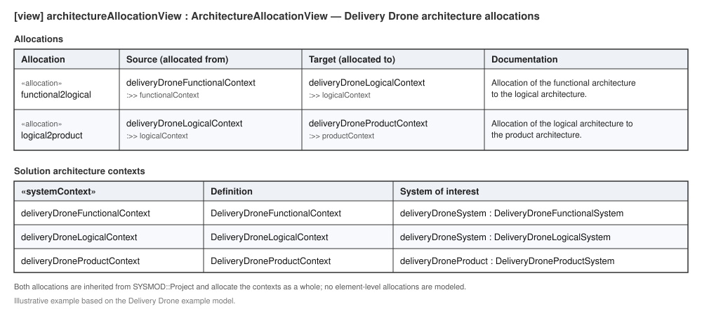

_Illustrative example based on the Delivery Drone example model ([architectureAllocationView.svg](examples/views/architectureAllocationView.svg))._

<a id="view-verificationandvalidationview"></a>

### VerificationAndValidationView

Product "Verification and Validation": the verificationCases of the verificationContext of the Project with the tested productSystem and the system requirements, stakeholder needs, and problem statement they verify and validate.

- **Specializes:** `GeneralView`

**Backward traceability**

- **SYSMOD steps:** —
- **Viewpoints:** [VerificationViewpoint](#viewpoint-verificationviewpoint), [ValidationViewpoint](#viewpoint-validationviewpoint)
- **Concerns:** [VerificationCoverage](#concern-verificationcoverage), [OperationalSuitability](#concern-operationalsuitability)
- **Stakeholders:** [VerificationEngineer](#stakeholder-verificationengineer), [RequirementsEngineer](#stakeholder-requirementsengineer), [ValidationEngineer](#stakeholder-validationengineer), [Operator](#stakeholder-operator), [Acquirer](#stakeholder-acquirer)
- **ISO 15288 processes:** [Verification](#process-verification), [Stakeholder Needs and Requirements Definition](#process-stakeholderneedsandrequirementsdefinition), [System Requirements Definition](#process-systemrequirementsdefinition), [Validation](#process-validation), [Operation](#process-operation), [Acquisition](#process-acquisition)

**Dependencies**

- **Shows artifacts:** `verificationContext.verificationCases`
- **Created by:** `VerifyAndValidateRequirements`
- **Builds on:** [SystemRequirementsView](#view-systemrequirementsview) (`systemRequirementSpecification`), [ProductArchitectureView](#view-productarchitectureview) (`productContextImpl`)
- **Information provided:** —
- **Traces to:** [ProductArchitectureView](#view-productarchitectureview) (verificationContext.verificationCases specializes productContextImpl)
- **Input for:** —

**Definition**

```sysml
view def VerificationAndValidationView :> StandardViewDefinitions::GeneralView {
    doc /* Product "Verification and Validation": the verificationCases of the verificationContext of the Project with the tested productSystem
            * and the system requirements, stakeholder needs, and problem statement they verify and validate.
            */
    satisfy requirement vvp : VerificationViewpoint;
    satisfy requirement valvp : ValidationViewpoint;
    filter @SysML::VerificationCaseUsage or @SysML::VerificationCaseDefinition
        or @SysML::RequirementUsage or @ExtendedRequirementMetadata;
    render Views::asTreeDiagram;
}
```

**Example**

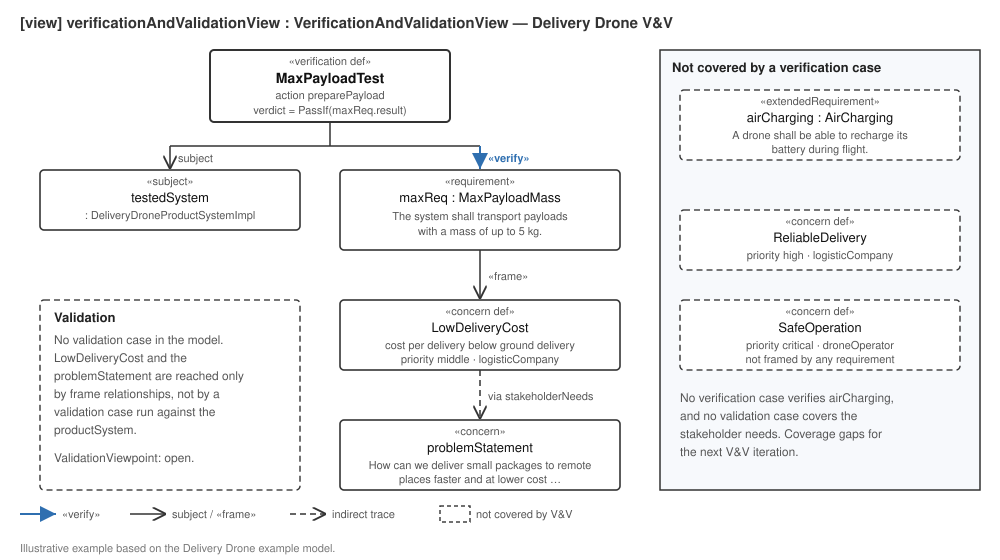

_Illustrative example based on the Delivery Drone example model ([verificationAndValidationView.svg](examples/views/verificationAndValidationView.svg))._

<a id="view-verificationmatrixview"></a>

### VerificationMatrixView

Product "Verification and Validation": matrix of the system requirements and the verificationCases that verify them.

- **Specializes:** `GridView`

**Backward traceability**

- **SYSMOD steps:** —
- **Viewpoints:** [VerificationViewpoint](#viewpoint-verificationviewpoint)
- **Concerns:** [VerificationCoverage](#concern-verificationcoverage)
- **Stakeholders:** [VerificationEngineer](#stakeholder-verificationengineer), [RequirementsEngineer](#stakeholder-requirementsengineer)
- **ISO 15288 processes:** [Verification](#process-verification), [Stakeholder Needs and Requirements Definition](#process-stakeholderneedsandrequirementsdefinition), [System Requirements Definition](#process-systemrequirementsdefinition)

**Dependencies**

- **Shows artifacts:** `verificationContext.verificationCases`
- **Created by:** `VerifyAndValidateRequirements`
- **Builds on:** [SystemRequirementsView](#view-systemrequirementsview) (`systemRequirementSpecification`), [ProductArchitectureView](#view-productarchitectureview) (`productContextImpl`)
- **Information provided:** —
- **Traces to:** [ProductArchitectureView](#view-productarchitectureview) (verificationContext.verificationCases specializes productContextImpl)
- **Input for:** —

**Definition**

```sysml
view def VerificationMatrixView :> StandardViewDefinitions::GridView {
    doc /* Product "Verification and Validation": matrix of the system requirements and the verificationCases that verify them. */
    satisfy requirement vvp : VerificationViewpoint;
    filter @SysML::VerificationCaseUsage or @SysML::RequirementUsage or @ExtendedRequirementMetadata;
    render Views::asElementTable;
}
```

**Example**

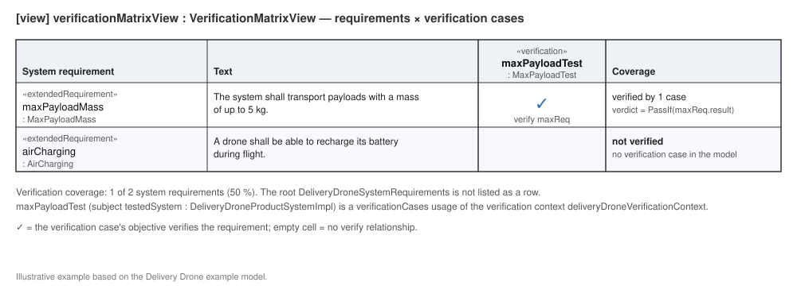

_Illustrative example based on the Delivery Drone example model ([verificationMatrixView.svg](examples/views/verificationMatrixView.svg))._

<a id="view-aiusecaseview"></a>

### AIUseCaseView

Classical use case view. Shows the use case definitions exposed by the view, together with their subjects and actors, as an AI-generated diagram.

- **Specializes:** —

**Backward traceability**

- **SYSMOD steps:** —
- **Viewpoints:** —
- **Concerns:** —
- **Stakeholders:** —
- **ISO 15288 processes:** —

**Dependencies**

_Not tied to Project artifacts; the view shows whatever a project exposes, e.g., a use case package._

**Definition**

```sysml
view def AIUseCaseView {
    doc /* Classical use case view. Shows the use case definitions exposed by the view,
         * together with their subjects and actors, as an AI-generated diagram.
         */
    filter @SysML::UseCaseDefinition;
    render asAIGenerated {
        doc /* Renders the view with AI, using a traditional use case notation. */
        :>> create_prompt = "Create a classical use case view showing the use cases exposed and filtered of the view in a traditional use case representation with stick figures for the actors, ellipse for the use case, and a boundary box around the use case for the subject.";
    }
}
```

Rendering `asAIGenerated`: Default AI rendering. Views redefine its create_prompt to describe their specific notation.

```sysml
rendering asAIGenerated : AIRendering[1] :> Views::renderings {
    doc /* Default AI rendering. Views redefine its create_prompt to describe their specific notation. */
}
```

**Example**

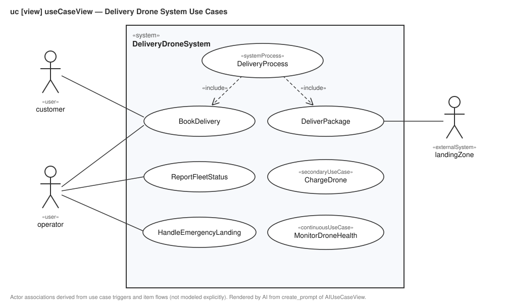

_Illustrative example based on the Delivery Drone example model ([useCaseView.svg](examples/views/useCaseView.svg))._

<a id="view-aiusecase4managersview"></a>

### AIUseCase4ManagersView

Management summary view. Shows the use case definitions exposed by the view as a single AI-generated slide for managers who do not read SysML.

- **Specializes:** —

**Backward traceability**

- **SYSMOD steps:** —
- **Viewpoints:** —
- **Concerns:** —
- **Stakeholders:** —
- **ISO 15288 processes:** —

**Dependencies**

_Not tied to Project artifacts; the view shows whatever a project exposes, e.g., a use case package._

**Definition**

```sysml
view def AIUseCase4ManagersView {
    doc /* Management summary view. Shows the use case definitions exposed by the view
         * as a single AI-generated slide for managers who do not read SysML.
         */
    filter @SysML::UseCaseDefinition;
    render as4Managers;
}
```

Rendering `as4Managers`: AI rendering that summarizes the exposed and filtered information as a single slide for managers.

```sysml
rendering as4Managers : AIRendering[1] :> Views::renderings {
    doc /* AI rendering that summarizes the exposed and filtered information as a single slide for managers. */
    :>> create_prompt = "Create a single slide that presents the exposed and filtered information from the view, summarizing it concisely for managers: What does this mean, and how can we use it to make decisions? Assume that the managers cannot read SysML.";
}
```

**Example**

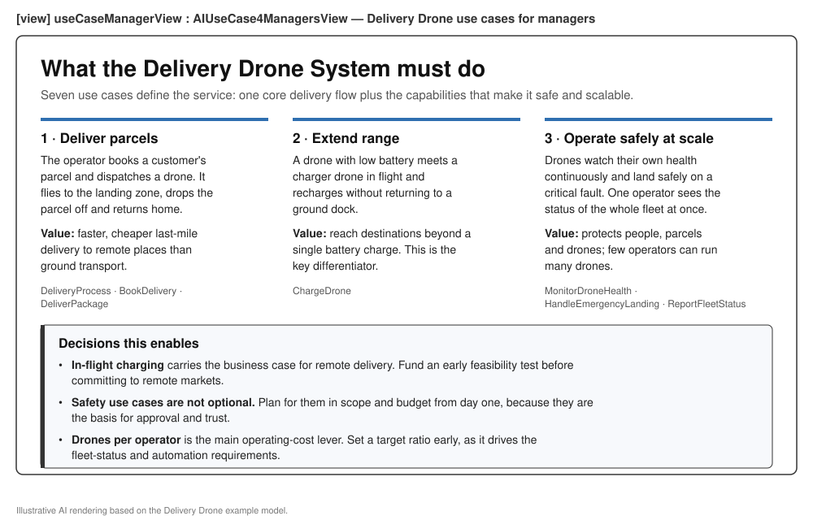

_Illustrative example based on the Delivery Drone example model ([useCaseManagerView.svg](examples/views/useCaseManagerView.svg))._

<a id="view-systemcontextview"></a>

### SystemContextView

Base view for the system contexts. Shows the parts, ports, interfaces, connections, and use cases of the exposed system context as an interconnection diagram, without library elements.

- **Specializes:** `InterconnectionView`
- **Specialized by:** [BrownfieldArchitectureView](#view-brownfieldarchitectureview), [SystemIdeaView](#view-systemideaview), [SpecificationSystemView](#view-specificationsystemview)

**Backward traceability**

- **SYSMOD steps:** —
- **Viewpoints:** —
- **Concerns:** —
- **Stakeholders:** —
- **ISO 15288 processes:** —

**Dependencies**

_Not tied to Project artifacts; the view shows whatever a project exposes, see its specializations._

**Definition**

```sysml
view def SystemContextView :> StandardViewDefinitions::InterconnectionView {
    doc /* Base view for the system contexts. Shows the parts, ports, interfaces, connections, and use cases
         * of the exposed system context as an interconnection diagram, without library elements.
         */
    filter @SysML::PartUsage or @SysML::PortUsage or @SysML::InterfaceUsage or @SysML::ConnectionUsage or @SysML::UseCaseUsage;
    filter not (@KerML::Element::isLibraryElement);
    render Views::asInterconnectionDiagram;
}
```

**Example**

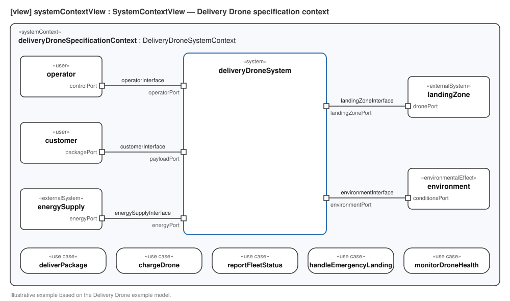

_Illustrative example based on the Delivery Drone example model ([systemContextView.svg](examples/views/systemContextView.svg))._

## 6. View Dependencies

The dependencies between the views are the correspondences of the SYSMOD architecture description framework in the sense of ISO/IEC/IEEE 42010. They are not maintained by hand but derived from the library:

- Each view definition names the Project features, i.e., the artifacts, that a conforming view shows (`#viewedArtifact` dependencies in [SYSMODViews.sysml](SYSMODViews.sysml)).
- **Builds on:** the SYSMOD step that creates the artifacts of a view reads artifacts that earlier steps created (the inputs of the step or of its nested action in `SYSMOD::SYSMODProcesses`). The view builds on the views showing these artifacts.
- **Traces to:** the Project relates its artifacts by model relationships, e.g., the specification context specializes the system idea context, the system requirements frame the stakeholder needs, and the product system satisfies the system requirements (`SYSMOD::Project`).
- **Information provided:** step inputs that no step creates, e.g., the problem statement text or a description of the existing architecture, given by a human or an AI assistant. Views with such inputs and without a *builds on* dependency are entry points.

A dependency states which content builds on which other content. It does not require the other view to be complete: SYSMOD lets you start with partial content, e.g., pitch the system idea before all stakeholder needs are elaborated, and revise earlier content when later steps reveal gaps. Following the dependencies keeps the content consistent and traceable; the default order is given by the SYSMOD process steps, and changes ripple along the *input for* direction.

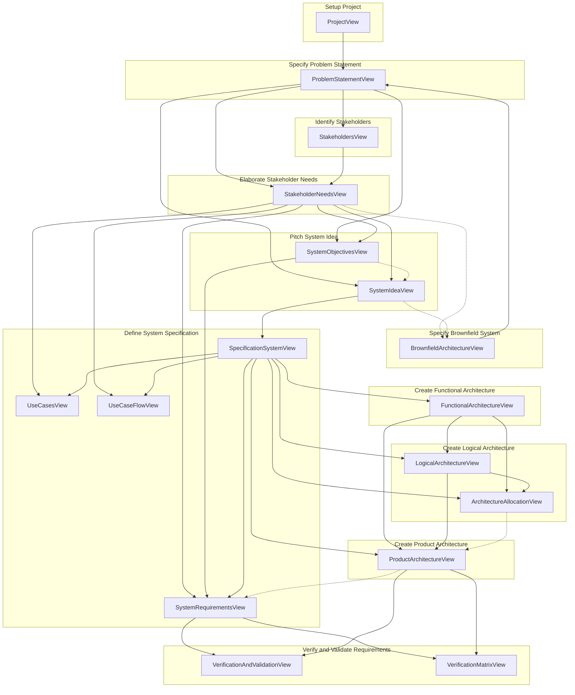

_Solid arrow: the target view builds on the source view. Dotted arrow: the source view traces to the target view by a model relationship only. Grouped by the SYSMOD step creating the content; views that inherit their artifacts, e.g., the AI views, are not shown and have the dependencies of their general view._

| View | Shows artifacts | Created by | Builds on | Information provided | Traces to | Input for |
|---|---|---|---|---|---|---|
| [ProjectView](#view-projectview) | `Project` | `SetupProject` | — | `projectOwnerName`, `projectPurpose` | — | [ProblemStatementView](#view-problemstatementview) |
| [ProjectAIView](#view-projectaiview) | `Project` | `SetupProject` | — | `projectOwnerName`, `projectPurpose` | — | — |
| [SYSMODMapView](#view-sysmodmapview) | `Project` | `SetupProject` | — | `projectOwnerName`, `projectPurpose` | — | — |
| [ProblemStatementView](#view-problemstatementview) | `problemStatement` | `SpecifyProblemStatement` | [ProjectView](#view-projectview), [BrownfieldArchitectureView](#view-brownfieldarchitectureview) | `problemStatementText` | [BrownfieldArchitectureView](#view-brownfieldarchitectureview) | [StakeholdersView](#view-stakeholdersview), [StakeholderNeedsView](#view-stakeholderneedsview), [SystemIdeaView](#view-systemideaview), [SystemObjectivesView](#view-systemobjectivesview) |
| [ProblemStatementAIView](#view-problemstatementaiview) | `problemStatement` | `SpecifyProblemStatement` | [ProjectView](#view-projectview), [BrownfieldArchitectureView](#view-brownfieldarchitectureview) | `problemStatementText` | [BrownfieldArchitectureView](#view-brownfieldarchitectureview) | — |
| [StakeholdersView](#view-stakeholdersview) | `projectStakeholders` | `IdentifyStakeholders` | [ProblemStatementView](#view-problemstatementview) | — | — | [StakeholderNeedsView](#view-stakeholderneedsview) |
| [StakeholderNeedsView](#view-stakeholderneedsview) | `stakeholderNeeds` | `ElaborateStakeholderNeeds` | [ProblemStatementView](#view-problemstatementview), [StakeholdersView](#view-stakeholdersview) | — | [ProblemStatementView](#view-problemstatementview), [BrownfieldArchitectureView](#view-brownfieldarchitectureview) | [SystemIdeaView](#view-systemideaview), [SystemObjectivesView](#view-systemobjectivesview), [UseCasesView](#view-usecasesview), [UseCaseFlowView](#view-usecaseflowview), [SystemRequirementsView](#view-systemrequirementsview) |
| [BrownfieldArchitectureView](#view-brownfieldarchitectureview) | `brownfieldContext`, `brownfieldContextImpl` | `SpecifyBrownfieldSystem` | — | `brownfieldArchitecture` | — | [ProblemStatementView](#view-problemstatementview) |
| [SystemIdeaView](#view-systemideaview) | `systemIdeaContext`, `systemIdeaContextImpl` | `PitchSystemIdea` | [ProblemStatementView](#view-problemstatementview), [StakeholderNeedsView](#view-stakeholderneedsview) | `systemIdeaArchitecture` | [BrownfieldArchitectureView](#view-brownfieldarchitectureview), [ProblemStatementView](#view-problemstatementview) | [SpecificationSystemView](#view-specificationsystemview) |
| [SystemObjectivesView](#view-systemobjectivesview) | `systemObjectives` | `PitchSystemIdea` | [ProblemStatementView](#view-problemstatementview), [StakeholderNeedsView](#view-stakeholderneedsview) | `systemIdeaArchitecture` | [StakeholderNeedsView](#view-stakeholderneedsview), [SystemIdeaView](#view-systemideaview) | [SystemRequirementsView](#view-systemrequirementsview) |
| [SpecificationSystemView](#view-specificationsystemview) | `specificationContext`, `specificationContextImpl` | `DefineSystemSpecification` | [SystemIdeaView](#view-systemideaview) | — | [SystemIdeaView](#view-systemideaview) | [UseCasesView](#view-usecasesview), [UseCaseFlowView](#view-usecaseflowview), [SystemRequirementsView](#view-systemrequirementsview), [FunctionalArchitectureView](#view-functionalarchitectureview), [LogicalArchitectureView](#view-logicalarchitectureview), [ProductArchitectureView](#view-productarchitectureview), [ArchitectureAllocationView](#view-architectureallocationview) |
| [UseCasesView](#view-usecasesview) | `specificationContext.useCases` | `DefineSystemSpecification` | [StakeholderNeedsView](#view-stakeholderneedsview), [SpecificationSystemView](#view-specificationsystemview) | — | — | — |
| [UseCaseFlowView](#view-usecaseflowview) | `specificationContext.useCases` | `DefineSystemSpecification` | [StakeholderNeedsView](#view-stakeholderneedsview), [SpecificationSystemView](#view-specificationsystemview) | — | — | — |
| [SystemRequirementsView](#view-systemrequirementsview) | `systemRequirementSpecification` | `DefineSystemSpecification` | [StakeholderNeedsView](#view-stakeholderneedsview), [SystemObjectivesView](#view-systemobjectivesview), [SpecificationSystemView](#view-specificationsystemview) | — | [StakeholderNeedsView](#view-stakeholderneedsview), [SpecificationSystemView](#view-specificationsystemview) | [VerificationAndValidationView](#view-verificationandvalidationview), [VerificationMatrixView](#view-verificationmatrixview) |
| [FunctionalArchitectureView](#view-functionalarchitectureview) | `functionalContext`, `functionalContextImpl` | `CreateFunctionalArchitecture` | [SpecificationSystemView](#view-specificationsystemview) | `functionalArchitecture` | [SpecificationSystemView](#view-specificationsystemview) | [LogicalArchitectureView](#view-logicalarchitectureview), [ProductArchitectureView](#view-productarchitectureview), [ArchitectureAllocationView](#view-architectureallocationview) |
| [LogicalArchitectureView](#view-logicalarchitectureview) | `logicalContext`, `logicalContextImpl` | `CreateLogicalArchitecture` | [SpecificationSystemView](#view-specificationsystemview), [FunctionalArchitectureView](#view-functionalarchitectureview) | `logicalArchitecture` | [SpecificationSystemView](#view-specificationsystemview) | [ProductArchitectureView](#view-productarchitectureview), [ArchitectureAllocationView](#view-architectureallocationview) |
| [ProductArchitectureView](#view-productarchitectureview) | `productContext`, `productContextImpl` | `CreateProductArchitecture` | [SpecificationSystemView](#view-specificationsystemview), [FunctionalArchitectureView](#view-functionalarchitectureview), [LogicalArchitectureView](#view-logicalarchitectureview) | `productArchitecture` | [SpecificationSystemView](#view-specificationsystemview), [SystemRequirementsView](#view-systemrequirementsview) | [VerificationAndValidationView](#view-verificationandvalidationview), [VerificationMatrixView](#view-verificationmatrixview) |
| [ArchitectureAllocationView](#view-architectureallocationview) | `functional2logical`, `logical2product`, `functionalImpl2logicalImpl`, `logicalImpl2productImpl` | `CreateLogicalArchitecture`, `CreateProductArchitecture` | [SpecificationSystemView](#view-specificationsystemview), [FunctionalArchitectureView](#view-functionalarchitectureview), [LogicalArchitectureView](#view-logicalarchitectureview) | `logicalArchitecture`, `productArchitecture` | [FunctionalArchitectureView](#view-functionalarchitectureview), [LogicalArchitectureView](#view-logicalarchitectureview), [ProductArchitectureView](#view-productarchitectureview) | — |
| [VerificationAndValidationView](#view-verificationandvalidationview) | `verificationContext.verificationCases` | `VerifyAndValidateRequirements` | [SystemRequirementsView](#view-systemrequirementsview), [ProductArchitectureView](#view-productarchitectureview) | — | [ProductArchitectureView](#view-productarchitectureview) | — |
| [VerificationMatrixView](#view-verificationmatrixview) | `verificationContext.verificationCases` | `VerifyAndValidateRequirements` | [SystemRequirementsView](#view-systemrequirementsview), [ProductArchitectureView](#view-productarchitectureview) | — | [ProductArchitectureView](#view-productarchitectureview) | — |

Not tied to Project artifacts: [SolutionArchitectureView](#view-solutionarchitectureview), [AIUseCaseView](#view-aiusecaseview), [AIUseCase4ManagersView](#view-aiusecase4managersview), [SystemContextView](#view-systemcontextview). They are base views or show whatever a project exposes, e.g., a use case package. See the views for the artifacts behind each dependency.
